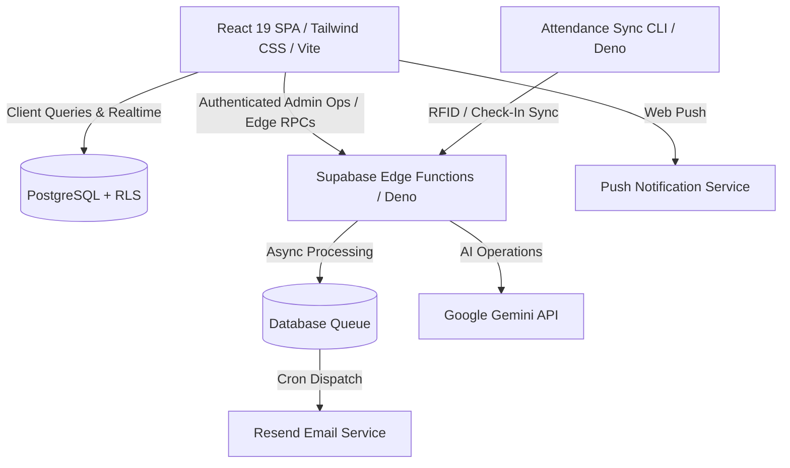
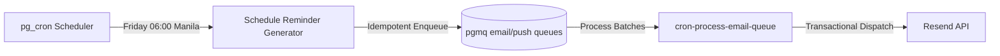

# WelcomeHub

> Modern Church Event, Member Service & Ministry Management Platform built with React 19, Vite, TypeScript, Tailwind CSS, and Supabase.

WelcomeHub is an all-in-one web platform and operational command center designed for modern ministry workflows. It unifies event registration, dynamic form submissions, Sunday service attendance, volunteer commitment tracking, turnup forecasting, multi-channel notification broadcasting, approval workflows, and administrative AI assistance.

---

## Table of Contents

- [Core Capabilities](#core-capabilities)
- [Architecture & Tech Stack](#architecture--tech-stack)
- [Role-Based Access Control (RBAC)](#role-based-access-control-rbac)
- [Mobile & Offline Experience](#mobile--offline-experience)
- [Attendance Sync CLI & Hardware Integration](#attendance-sync-cli--hardware-integration)
- [Scheduled Automations & Background Jobs](#scheduled-automations--background-jobs)
- [Repository Structure](#repository-structure)
- [Route Map](#route-map)
- [Development Setup](#development-setup)
- [Environment Variables Reference](#environment-variables-reference)
- [Deployment & Hosting](#deployment--hosting)
- [Testing & Quality Verification](#testing--quality-verification)
- [Edge Functions & Security](#edge-functions--security)
- [Data & Member Seed Workflow](#data--member-seed-workflow)
- [Database Backups & Recovery](#database-backups--recovery)
- [Contribution & Git Workflow](#contribution--git-workflow)
- [Documentation Index](#documentation-index)

---

## Core Capabilities

### 1. Unified Hub & Registrations

- **Mixed Hub Feed**: Curated home feed displaying active events and published forms side-by-side with visual categorization.
- **ID-First Auto-Lookup**: Automatic member verification using session credentials; members review and confirm details before finalizing registration.
- **Dynamic Field Engine**: Modular custom fields across events and forms (text, phone, select, radio, multi-select, attendance tracking) with dependency visibility rules (`validation_rules.visibility_rule`).
- **Event Countdown & Attendance Kiosk**: Real-time event countdown screens, kiosk check-in mode, and fast attendee lookups.

### 2. Service Attendance & Layouts

- **Service Commitments**: Sunday volunteer commitment tracking (`first_sunday` through `fifth_sunday`) with automated historical snapshots in `user_commitment_history`.
- **RFID & Member Tagging**: Seamless integration of RFID identifiers mapped directly to member profiles.
- **Interactive Seat Layouts**: Configurable physical layouts and seat assignment maps for service venues.
- **Attendance Sync Tool**: Standalone Deno/Node desktop synchronization CLI (`tools/attendance-sync`) supporting Windows `.exe` and macOS native binaries.

### 3. Hub Calendar & Turnup Forecasting

- **Volunteer Turnup Forecasts**: Statistical turnout projections categorizing volunteers into `Solid`, `Moderate`, `At Risk`, or `Excused` tiers.
- **Member Attendance Rating (MAR)**: Interactive scoring and dynamic avatar indicator rings (`ring-emerald-500`, `ring-indigo-500`, `ring-amber-500`, `ring-rose-500`).
- **Schedule Exports**: Specialized Sunday schedule CSV generation with turnup confidence levels and privacy safeguards.

### 4. Dynamic Forms Entity

- **Independent Form Builder**: Standalone data-gathering forms with configurable dynamic field definitions.
- **Granular Audience Rules**: Target `members`, `public`, or `members_and_public`.
- **Flexible Submission Policies**: Duplicate protection modes including `block`, `allow_update`, `allow_multiple`, and `allow_multiple_update`.

### 5. Unified Approval Workflow & SLOD Delegation

- **Centralized Approvals Queue**: Integrated review queue at `/admin/approvals` for both dynamic form submissions and Volunteer Long Leave requests.
- **SLOD Review Delegation**: Assign review requests to Service Leader of the Day (SLOD) volunteers with secure, tokenized review URLs (`/approvals/review/:token`).
- **Volunteer Long Leave (Service Excuses)**: Self-service request filing for extended service leaves; approved excuses automatically update Hub Calendar schedules.

### 6. Multi-Channel Notifications & Broadcasting

- **Simultaneous Multi-Channel Dispatch**: Admin broadcasting via Web Push (VAPID) and transactional Email (Resend) in a single operation.
- **Audience Targeting Engine**: Target by `all`, `role` (Admin/Volunteer roles), specific `user`, or `event` attendee rosters.
- **Real-Time Reach Verification**: Live pre-flight audience estimation with recipient safety confirmation dialogs before dispatching.
- **Notification Drawer**: Main header notification center with live Supabase Realtime updates, unread indicators, and read state management.

### 7. AI Chat Assistant

- **Admin Chat Portal**: Conversational operational assistant at `/admin/chat` powered by Google Gemini and Supabase Edge Functions.
- **Custom Chat Tools**: Domain-specific query tools under `supabase/functions/chat/tools/` utilizing standardized timeframe schemas.

---

## Architecture & Tech Stack



### Frontend

- **Framework**: React 19, TypeScript 5, Vite
- **Routing**: React Router 6 with lazy route chunking and code splitting
- **Server State**: TanStack React Query v5
- **Forms & Validation**: React Hook Form with Zod schema inference
- **Styling & UI**: Tailwind CSS, Radix UI primitives, Lucide icons, Sonner toast notifications
- **Image Sharing**: Compound `ImageCanvas` pattern for DOM-to-image card generation and sharing
- **Design Tokens**: Centralized CSS custom property variables on `:root` (semantic tokens like `bg-surface`, `text-primary`, `border-border`; strict no `dark:` variant policy)

### Backend & Infrastructure

- **Database**: Supabase PostgreSQL with Row Level Security (RLS) on all tables and `with (security_invoker = true)` on views
- **Serverless Compute**: Supabase Edge Functions (Deno + TypeScript)
- **Authentication**: Google OAuth for member identity; email/password for administrative roles (`super_admin`, `admin`, `slod`, `imt`, `kiosk`)
- **Asset Storage**: Supabase Storage buckets for event banners, form attachments, and avatars
- **Automated Backups**: Weekly database backups to Cloudflare R2 storage

---

## Role-Based Access Control (RBAC)

WelcomeHub enforces strict role separation across administrative roles, volunteer leads, and general members:

| Role               | Target Users                | Key Permissions & Access Scope                                                                                                                 |
| :----------------- | :-------------------------- | :--------------------------------------------------------------------------------------------------------------------------------------------- |
| `super_admin`      | Platform Owners             | Full administrative privileges across all modules, plus exclusive role assignment management at `/admin/settings/roles`.                       |
| `admin`            | Ministry Operations Staff   | Full access to Events, Forms, Members, Service Layouts, Calendar, Approvals, and Multi-Channel Broadcasting.                                   |
| `slod`             | Service Leader of the Day   | Read access to members and schedules, service management, attendance saved views, report exports, and delegated approval reviews.              |
| `imt`              | Info Management Team        | Read-only access to member directory profiles and aggregate attendance dashboards.                                                             |
| `kiosk`            | Dedicated Terminal Stations | Restricted check-in kiosk access (`canAccessAttendanceCheckIn`) for event and service registration desks.                                      |
| Member / Volunteer | Church Congregation         | Authenticated via Google OAuth; read-only access to personal profile, attendance history, and self-service leave requests (`/excuse-request`). |

---

## Mobile & Offline Experience

WelcomeHub is engineered to work reliably on mobile devices, volunteer tablets, and event kiosks:

- **Adaptive Viewport Rendering**: Data lists automatically swap between dense desktop tables (`ListTable`) and touch-optimized cards (`MobileCard`) via `useIsMobileViewport`.
- **Web Push & PWA Readiness**: Native service worker (`public/sw.js`) handles background Web Push notifications and provides deep links directly to schedules and announcements.
- **Connectivity Awareness**: An integrated offline detector (`useOnlineStatus`) surfaces contextual status alerts when devices temporarily drop connection in venue dead zones.
- **Kiosk Inactivity Guard**: Registration kiosks automatically reset to the welcome screen after user inactivity, while keeping authenticated member personal workflows active.

---

## Attendance Sync CLI & Hardware Integration

For venues utilizing physical RFID cards or barcode scanners, a standalone synchronization client lives under `tools/attendance-sync`:

```text
Physical Scanner ──> Kiosk SQLite DB (wc_attend.db) ──> Standalone Sync CLI ──> Supabase Edge Function
```

### Key Highlights

- **Zero Kiosk Database Credentials**: Scanners and kiosk laptops never hold Supabase database passwords or service role secrets.
- **Scoped API Key**: Authenticates exclusively via a rotating `ATTENDANCE_SYNC_KEY` header (`X-Sync-Key`).
- **Read-Only SQLite Engine**: Monitors `wc_attend.db` with native Node.js `node:sqlite` (zero native C++ build tool dependencies).
- **Cross-Platform Binaries**: Pre-compilable into standalone self-contained binaries for Windows and macOS:

  ```bash
  # Compile for Windows x64
  npm run build:sync:exe

  # Compile for Apple Silicon macOS
  npm run build:sync:mac
  ```

---

## Scheduled Automations & Background Jobs

Automated background jobs are coordinated using PostgreSQL `pg_cron`, PGMQ queues, and Supabase Edge Functions:



1. **Automated Sunday Email Reminders**:
   - Triggers every Friday at 06:00 Asia/Manila (`0 22 * * 4` UTC).
   - Resolves upcoming Sunday service commitments and queues idempotent reminders with zero duplicate sends.
2. **Automated Sunday Push Reminders**:
   - Dispatches native Web Push reminders with deep links directly to `/profile?tab=commitments`.
   - Automatically prunes dead or unsubscribed VAPID push subscriptions upon receipt of `410 Gone` responses.
3. **Email Queue Processing Sweep**:
   - Runs every 15 minutes (`*/15 * * * *`) via `cron-process-email-queue` to retry transient network delivery failures.

---

## Repository Structure

```text
.
├── .agent/                  # Specialized agent skills, guidelines, and rules
├── docs/                    # Architecture documentation, features, and operational guides
│   ├── features/            # Feature-by-feature specifications and user journeys
│   └── guides/              # Deep-dive engineering guides (Calendar, Notifications, Approvals)
├── scripts/                 # CI gates, pre-commit runners, seed generators, and maintenance scripts
├── src/
│   ├── app/                 # Router definitions and top-level application providers
│   ├── components/          # Reusable UI primitives, layout shells, and dynamic field renderers
│   ├── config/              # Constants, legal configurations, and route path registries
│   ├── hooks/               # Custom hooks (domain hooks under src/hooks/domain/)
│   ├── lib/                 # Core domain logic, API clients, and infrastructure utilities
│   └── pages/               # Page components organized by domain (public, member, admin)
├── supabase/
│   ├── functions/           # Supabase Edge Functions (Deno)
│   │   ├── _shared/         # Shared security, rate limiting, and email utilities
│   │   ├── chat/            # AI assistant edge endpoint and custom tools
│   │   └── send-app-notification/ # Notification dispatch engine
│   ├── migrations/          # Versioned, idempotent SQL schema migrations
│   └── seeds/               # Local database development seeds
└── tools/
    └── attendance-sync/     # Standalone attendance check-in synchronization tool
```

---

## Route Map

### Member & Public Routes

| Route                           | Description                                                          |
| :------------------------------ | :------------------------------------------------------------------- |
| `/`                             | Main Hub feed featuring active events and published forms            |
| `/events/:slug/register`        | Member event registration with ID lookup and dynamic fields          |
| `/events/:slug/register-public` | Public/guest event registration flow                                 |
| `/events/:slug/countdown`       | Event countdown timer and launch display                             |
| `/forms/:slug/submit`           | Dynamic form submission page                                         |
| `/login`                        | Authentication entry point (Google OAuth & Admin sign-in)            |
| `/profile`                      | Authenticated member profile, event history, and service commitments |
| `/excuse-request`               | Member self-service leave/service excuse request form                |
| `/approvals/review/:token`      | External SLOD reviewer tokenized approval review portal              |
| `/privacy` / `/terms`           | Organization privacy policy and terms of service                     |

### Admin Management Portal (`/admin/*`)

| Route                           | Description                                                                |
| :------------------------------ | :------------------------------------------------------------------------- |
| `/admin/events`                 | Event management, creation, dynamic fields configuration, and rosters      |
| `/admin/events/:id/attendance`  | Event check-in kiosk, manual attendance logging, and bulk CSV uploads      |
| `/admin/forms`                  | Dynamic form management, field definitions, and submissions log            |
| `/admin/members`                | Member directory, profile details, service history, and CSV batch import   |
| `/admin/services`               | Service layout designer, attendance tracking, and Sunday commitment stats  |
| `/admin/hub-calendar`           | Sunday schedule calendar, attendance ratings, and turnup forecasting       |
| `/admin/approvals`              | Unified review queue for form submissions and volunteer leave requests     |
| `/admin/settings/notifications` | Multi-channel broadcasting (Push + Email) and dispatch logs                |
| `/admin/settings/roles`         | RBAC management for admin, SLOD, IMT, and kiosk users (`super_admin` only) |
| `/admin/chat`                   | AI administrative assistant with integrated database tools                 |

---

## Development Setup

### Prerequisites

- **Node.js**: `v22` (matches CI and production target)
- **npm**: `10.9.2`
- **Docker Desktop**: Required to run the local Supabase stack
- **Supabase CLI**: Installed globally or executed via npx

### 1. Repository Setup & Dependencies

```bash
# Ensure correct node and npm versions
nvm use 22
npm install --global npm@10.9.2

# Clean install dependencies from package-lock.json
npm ci
```

### 2. Environment Configuration

Copy the template and configure your local environment settings:

```bash
cp .env.example .env.local
```

### 3. Local Supabase Stack

```bash
# Start local Supabase containers (PostgreSQL, Auth, Storage, Studio)
npm run supabase:start

# Check service URLs and retrieve credentials
npm run supabase:status

# Reset database and apply all migrations
npm run supabase:db:reset
```

### 4. Running the Development Server

```bash
# Start Vite frontend dev server (http://localhost:5173)
npm run dev

# Or run frontend, Edge Functions, and test watchers concurrently
npm run dev:all
```

---

## Environment Variables Reference

A quick reference for required configuration values in `.env.local` and Supabase secrets:

| Variable                                 | Scope                     | Required | Description                                                               |
| :--------------------------------------- | :------------------------ | :------: | :------------------------------------------------------------------------ |
| `VITE_SUPABASE_URL`                      | Frontend                  |   Yes    | Supabase project API gateway URL (e.g. `http://127.0.0.1:54321` locally). |
| `VITE_SUPABASE_PUBLISHABLE_KEY`          | Frontend                  |   Yes    | Supabase client anon / publishable key.                                   |
| `VITE_VAPID_PUBLIC_KEY`                  | Frontend                  | Optional | VAPID public key for browser Web Push subscription registration.          |
| `ALLOWED_ORIGINS`                        | Edge Functions            |   Yes    | Explicit comma-separated CORS allowlist (e.g. `http://localhost:5173`).   |
| `RUNTIME_ENV`                            | Edge Functions            |   Yes    | Environment tier: `local`, `staging`, or `production`.                    |
| `RESEND_API_KEY`                         | Edge Functions            | Optional | API key for transactional email deliveries via Resend.                    |
| `RESEND_FROM_EMAIL`                      | Edge Functions            | Optional | Verified sender email address used for transactional dispatches.          |
| `GOOGLE_API_KEY`                         | Edge Functions            | Optional | Google Gemini API key powering `/admin/chat` AI tools.                    |
| `VAPID_PUBLIC_KEY` / `VAPID_PRIVATE_KEY` | Edge Functions            | Optional | Cryptographic key pair for signing Web Push notification payloads.        |
| `ATTENDANCE_SYNC_KEY`                    | Edge Functions / Sync CLI | Optional | Secret authentication key safeguarding `/sync-kiosk-attendance`.          |
| `CRON_ROLE_KEY`                          | Edge Functions            | Optional | Secure secret token authorizing internal `pg_cron` worker execution.      |

> _Tip: In local development, leaving `RESEND_API_KEY` blank or setting `LOCAL_BROADCAST=true` automatically routes emails into local development log files instead of delivering real messages._

---

## Deployment & Hosting

WelcomeHub follows a decoupled hosting model: the React frontend SPA is deployed to **Vercel**, while the PostgreSQL database, Auth, Storage, and serverless Edge Functions are hosted on **Supabase**.

### 1. Pre-Flight Production Validation

Before deploying to production or rolling out environment configuration changes, run the automated environment validation check:

```bash
npm run env:validate:production
```

This script audits your production environment file (or `.env.production`) to verify that:

- Required production variables (`VITE_SUPABASE_URL`, `VITE_SUPABASE_ANON_KEY`, `ALLOWED_ORIGINS`, `RUNTIME_ENV`) are set.
- `RUNTIME_ENV` is strictly `production`.
- `VITE_SUPABASE_URL` enforces `https://`.
- `ALLOWED_ORIGINS` contains valid HTTPS domains and strictly denies loopback or localhost origins (`localhost`, `127.0.0.1`, `::1`).

### 2. Frontend Deployment (Vercel)

The web client is configured for zero-config Vercel deployment:

- **Build Command**: `npm run build` (`tsc -b && vite build`)
- **Output Directory**: `dist`
- **Node.js Runtime**: Set to `22.x` (configured via `.nvmrc`)
- **SPA & Open Graph Rewrites**: Defined in `vercel.json` to handle client-side routing fallbacks (`/(.*) -> /index.html`) and dynamic social share card generation (`/api/og`).
- **Cache-Control Headers**: Service worker assets (`/sw.js`) are configured with `public, max-age=0, must-revalidate` to ensure prompt PWA updates across client browsers.

### 3. Backend & Edge Function Deployment (Supabase)

```bash
# 1. Authenticate and link your remote Supabase project
supabase login
supabase link --project-ref <your-project-ref>

# 2. Push pending database migrations
supabase db push

# 3. Configure production Edge Function secrets
supabase secrets set \
  ALLOWED_ORIGINS="https://your-domain.com" \
  RUNTIME_ENV="production" \
  RESEND_API_KEY="your-resend-key" \
  RESEND_FROM_EMAIL="noreply@your-domain.com" \
  ATTENDANCE_SYNC_KEY="your-sync-key" \
  CRON_ROLE_KEY="your-cron-key"

# 4. Deploy serverless Edge Functions
supabase functions deploy
```

---

## Testing & Quality Verification

WelcomeHub enforces strict automated test and validation lanes to ensure platform stability:

```text
Fast Verification (~2-6s) ──> npm run precommit   (Lint, Types, Unit Tests on changed files)
Full CI Pipeline         ──> npm run ci:gate     (End-to-end lint, type-check, and coverage)
```

### Essential Test Commands

| Command                    | Description                                                                                                                                |
| :------------------------- | :----------------------------------------------------------------------------------------------------------------------------------------- |
| `npm run precommit`        | **Fast pre-commit runner**: Validates formatting, ESLint, TypeScript types, Vitest unit tests, and Deno tests for modified files in ~2-6s. |
| `npm run test:unit`        | Executes all frontend Vitest unit and component tests.                                                                                     |
| `npm run test:coverage`    | Runs unit tests and produces Istanbul coverage reports.                                                                                    |
| `npm run test:edge`        | Executes Deno tests for all Supabase Edge Functions (`supabase/functions/`).                                                               |
| `npm run test:integration` | Runs full database integration tests (requires service role key).                                                                          |
| `npm run ci:gate`          | Comprehensive CI validation runner executing full linting, builds, and test coverage.                                                      |
| `npm run format`           | Automatically formats the repository using Prettier.                                                                                       |

---

## Edge Functions & Security

### In-Memory Rate Limiting

Public and administrative Edge Functions are guarded by an in-memory fixed-window limiter (`supabase/functions/_shared/security.ts`):

- **Public Endpoints** (e.g., `member-lookup`, `submit-registration`): Throttled by client IP (`x-forwarded-for`, `x-real-ip`, or `cf-connecting-ip`).
- **Admin Endpoints** (e.g., `export-registrations-csv`, `cancel-registration`): Throttled by authenticated user identity.
- Exceeded thresholds return `HTTP 429` with `Retry-After` headers.

### CORS & Origin Protection

- Edge Functions check `ALLOWED_ORIGINS` on incoming requests.
- Fail-closed behavior: If `ALLOWED_ORIGINS` is unset, cross-origin requests are rejected.
- Production safety: `localhost` and loopback IPs (`127.0.0.1`, `::1`) are strictly rejected in `production` environments.

### Local Broadcast Simulation Harness

When executing in local development (`LOCAL_BROADCAST=true` or non-production environment without active Resend API keys), all notification email dispatches through `sendResendEmail` are safely simulated and logged locally (`local-broadcasts.log`) instead of reaching external email addresses.

---

## Data & Member Seed Workflow

For reproducible local development without exposing private member data:

1. Place source CSV data in `members_info.csv` (git-ignored).
2. Generate the private local SQL seed:
   ```bash
   npm run seed:members:generate
   ```
3. Apply the generated seed (`supabase/seeds/members.local.sql`):
   ```bash
   npm run supabase:db:reset
   ```

### Default Local Admin Credentials

For testing admin routes locally:

- **Email**: `local@admin.com`
- **Password**: `Supabase@123`
- **Source**: `supabase/seeds/dev.local.sql`

---

## Database Backups & Recovery

The production database is automatically backed up every Monday at 01:00 AM PHT via GitHub Actions (`.github/workflows/supabase-backup.yml`) and stored in Cloudflare R2 object storage.

- **Backup Guide**: Detailed architecture and automation procedures in [docs/backup-guide.md](docs/backup-guide.md).
- **Restore Guide**: Step-by-step restoration walkthrough in [docs/restore-guide.md](docs/restore-guide.md).

---

## Contribution & Git Workflow

- **Branch Naming**: Use descriptive prefixes: `feature/*`, `fix/*`, `chore/*`, or `docs/*`.
- **Pre-Commit Verification**: Run `npm run precommit` before committing to catch formatting, type errors, or test regressions in seconds.
- **Pull Requests**: Pull Requests are merged exclusively through human review; automated agents may create PRs (`gh pr create`) but never auto-merge.
- **Repository Hygiene**: Run `npm run git:clean` periodically to automatically scan and prune local branches that have been merged upstream.

---

## Documentation Index

Detailed engineering guides and architectural records are maintained in the repository:

- **AI Guidelines**: [AGENTS.md](AGENTS.md) – Operational guidelines, architectural rules, and TypeScript standards.
- **Frontend Styleguide**: [docs/STYLEGUIDE.md](docs/STYLEGUIDE.md) – Tailwind token enforcement, accessibility, and component guidelines.
- **Hub Calendar & MAR Rating**: [docs/guides/hub-calendar-forecast-and-attendance-rating.md](docs/guides/hub-calendar-forecast-and-attendance-rating.md) – Turnup statistical forecasting model.
- **Unified Approvals & SLOD**: [docs/guides/unified-approval-workflow-and-slod-delegation.md](docs/guides/unified-approval-workflow-and-slod-delegation.md) – Review delegation workflows.
- **Multi-Channel Notifications**: [docs/guides/notifications-deployment-and-mobile-testing.md](docs/guides/notifications-deployment-and-mobile-testing.md) – Push & Email architecture.
- **Automated Sunday Reminders**: [docs/guides/automated-sunday-email-reminders.md](docs/guides/automated-sunday-email-reminders.md) and [docs/guides/automated-sunday-push-reminders.md](docs/guides/automated-sunday-push-reminders.md) – Scheduling and queue mechanics.
- **Event Lifecycle**: [docs/guides/event-creation-lifecycle.md](docs/guides/event-creation-lifecycle.md) – End-to-end event lifecycle and storage handling.
- **Form Lifecycle**: [docs/guides/form-creation-lifecycle.md](docs/guides/form-creation-lifecycle.md) – Form builder and submission pipeline.
- **Feature Catalog**: [docs/features/README.md](docs/features/README.md) – Index of core system features.
