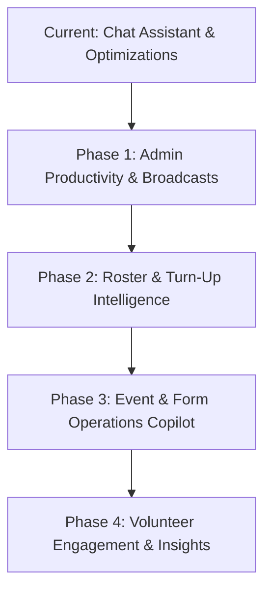

# AI Integration Roadmap & Phased Implementation Plan

This document outlines the architectural blueprint, phased implementation roadmap, and cost-feasibility analysis for expanding Generative AI capabilities across Welcome Hub using **Gemini 3.5 Flash-Lite**.

---

## 1. Executive Summary & Budget Headroom

- **Monthly Budget**: $10.00 / month (rolling).
- **Target Model**: `gemini-3.5-flash-lite` (Configured via `GOOGLE_AI_MODEL`).
- **Cost Characteristics**:
  - **Input Tokens**: $0.0375 / 1,000,000 tokens.
  - **Output Tokens**: $0.1500 / 1,000,000 tokens.
- **Budget Capacity**: **~75,000 requests per month** (~230M total tokens).
- **Projected Consumption**: Even with all 4 phases fully deployed, projected consumption is **< $1.00 / month** (< 10% of total budget headroom).

---

## 2. Phased Implementation Roadmap

### Phase Matrix

| Phase         | Feature / Capability                          | Target Surface                  | Complexity | Monthly Token Impact | Est. Monthly Cost |
| :------------ | :-------------------------------------------- | :------------------------------ | :--------: | :------------------: | :---------------: |
| **Phase 1.1** | **Broadcast AI Draft Assistant**              | `/admin/notifications`          |    Low     |    ~60,000 tokens    |      < $0.01      |
| **Phase 1.2** | **Weekly Sunday Debrief Cron**                | Edge Function (`cron`)          |    Low     |    ~25,000 tokens    |      < $0.01      |
| **Phase 2.1** | **Smart Stand-In / Substitute Recommender**   | `/admin/hub-calendar`           |   Medium   |   ~200,000 tokens    |      ~$0.02       |
| **Phase 2.2** | **Leave Request Impact Summarizer**           | `/admin/approvals`              |    Low     |    ~80,000 tokens    |      < $0.01      |
| **Phase 3.1** | **Event & Form Generation Copilot**           | `/admin/events`, `/admin/forms` |   Medium   |   ~350,000 tokens    |      ~$0.04       |
| **Phase 3.2** | **Form Feedback Sentiment & Theme Extractor** | `/admin/forms/[id]`             |   Medium   |   ~500,000 tokens    |      ~$0.06       |
| **Phase 4.1** | **Milestone Anniversary Encouragement**       | `/admin/members`                |    Low     |   ~150,000 tokens    |      ~$0.02       |
| **Phase 4.2** | **Quarterly Volunteer Service Recap**         | Member Profile (`/profile`)     |    High    |   ~800,000 tokens    |      ~$0.09       |

---

## 3. Phase Details & Technical Specifications

### Phase 1: High-Impact Admin Productivity & Automated Briefings

#### Phase 1.1: Broadcast AI Draft Assistant & Tone Polisher `[Completed]`

- **Location**: Broadcast creation form in [`/admin/settings/notifications`](file:///Users/baronpatrickparedes/Projects/wc-event-registration/src/pages/admin/settings/notifications).
- **User Workflow**:
  1. Admin clicks **"Draft with Hub AI"** in the Broadcast section card header.
  2. Input: Quick bullet points or notes (or pre-fills existing draft when switching to "Polish Existing" mode).
  3. Tone Selection: Pastoral & Warm, Urgent & Direct, or Informative & Clear.
  4. Edge Function dispatches prompt to Gemini Flash-Lite (`gemini-3.5-flash-lite`).
  5. Returns structured drafts:
     - **Push Notification**: Action-oriented title (<= 100 chars) and concise body (<= 500 chars).
     - **Email / In-App Announcement**: Structured, pastoral subject (<= 100 chars) and message (<= 500 chars).
  6. Admin previews drafts across channel tabs, can copy to clipboard, or apply directly into the broadcast form with 1 click.
- **Architecture**:
  - Edge Function: `supabase/functions/generate-broadcast-draft/` with rate limiting, admin-role verification, and strict length clamping.
  - API Client: Strongly typed `generateBroadcastDraft` in `src/lib/domain/notifications/api.ts` via `createEdgeFunctionCaller`.
  - Frontend Hook: `useBroadcastDraftAi` in `src/hooks/domain/notifications/useBroadcastDraftAi.ts`.
  - UI Component: `BroadcastDraftAiModal` in `src/pages/admin/settings/notifications/components/BroadcastDraftAiModal.tsx`.

#### Phase 1.2: Weekly Sunday Executive Debrief (Automated Cron)

- **Location**: Automatic Monday 8:00 AM Manila time cron.
- **User Workflow**:
  - Automatically queries `get_service_dashboard_stats` for the previous Sunday.
  - Generates a concise, 3-paragraph executive brief highlighting:
    1. Overall turn-up rate and peak attendance slot.
    2. Role surplus and deficit highlights (e.g. _"Prayer coaches reached 110% target, while 12NN Ushers experienced a 3-person deficit"_).
    3. Notable anomalies or walk-in counts.
  - Stores summary in `service_weekly_briefs` table and broadcasts notification to `slod` and `admin` roles.

---

### Phase 2: Roster & Attendance Intelligence

#### Phase 2.1: Smart Stand-In / Substitute Recommender

- **Location**: Hub Calendar deficit cells and volunteer drawer ([`/admin/hub-calendar`](file:///Users/baronpatrickparedes/Projects/wc-event-registration/src/pages/admin/hub-calendar)).
- **User Workflow**:
  1. When a slot exhibits a deficit or an excused absence is logged, an **"AI Suggest Stand-in"** trigger appears.
  2. The tool queries active volunteers with:
     - Matching primary role (ignoring secondary roles).
     - Clean schedule (no commitment on that Sunday/slot).
     - High Attendance Rating Score ($\ge 8.0$).
     - No recent absence streak.
  3. Returns ranked top 3 volunteer tokens with a pre-drafted direct message invitation.

#### Phase 2.2: Leave Request Impact Summarizer

- **Location**: Approval drawer in [`/admin/approvals`](file:///Users/baronpatrickparedes/Projects/wc-event-registration/src/pages/admin/approvals).
- **User Workflow**:
  - When an admin or SLOD user reviews a 4+ week service excuse, the modal automatically evaluates schedule impact:
  - _Example Alert_: `"Approving this leave will leave the 12NN Prayer Coach roster at a deficit on Nov 15 & Nov 22 based on forecasted turnup."`
  - Prevents blind approvals that leave Sunday services understaffed.

---

### Phase 3: Event & Form Operations Copilot

#### Phase 3.1: Event & Form One-Click Generator

- **Location**: [`/admin/events/new`](file:///Users/baronpatrickparedes/Projects/wc-event-registration/src/pages/admin/events) and [`/admin/forms/new`](file:///Users/baronpatrickparedes/Projects/wc-event-registration/src/pages/admin/forms).
- **User Workflow**:
  - Admin inputs prompt: _"Couples Retreat registration with childcare, dietary restrictions, and emergency contact."_
  - AI outputs structured JSON conforming to `DynamicField` registry types (`text`, `number`, `select`, `multiselect`, `radio`, `rating`, `date`).
  - Pre-populates title, slug, description, and sets up field visibility dependency rules automatically.

#### Phase 3.2: Form Feedback Sentiment & Theme Extractor

- **Location**: Form submissions analysis view.
- **User Workflow**:
  - Ingests free-text submission answers across hundreds of responses.
  - Synthesizes feedback into:
    - **Top Praises** (What attendees loved).
    - **Actionable Critiques** (Common complaints, e.g., acoustics, venue temperature).
    - **Categorized Sentiments** (Positive / Neutral / Needs Attention).

---

### Phase 4: Volunteer Engagement & Member Personalization

#### Phase 4.1: Milestone & Anniversary Encouragement

- **Location**: [`/admin/members`](file:///Users/baronpatrickparedes/Projects/wc-event-registration/src/pages/admin/members) and automated reminder notifications.
- **User Workflow**:
  - Automatically identifies volunteer service milestones (e.g. 1 year serving, 50th service check-in, wedding anniversary).
  - Drafts personalized pastoral encouragement notes that ministry leaders can send via 1-click push or email.

#### Phase 4.2: Annual/Quarterly Volunteer Service Recap

- **Location**: Member Profile ([`/profile?tab=commitments`](file:///Users/baronpatrickparedes/Projects/wc-event-registration/src/pages/profile)).
- **User Workflow**:
  - Generates an interactive "Spotify Wrapped" style recap of a volunteer's ministry journey:
    - Total services served, peak hours, milestones achieved, and personalized thanksgiving message.

---

## 4. Privacy, Security & Token Optimization Standard

All future AI integrations in this repository must strictly adhere to the following architecture rules:

1. **Zero PII Leakage**:
   - Prompts must never send raw member names, emails, or phone numbers to external models.
   - Always operate on anonymous database tokens (`USR_000001`). Client frontend untokenizes responses into names.
2. **Minified Schemas**:
   - Tool schemas must omit verbose descriptive filler. Keep descriptions under 1 sentence.
3. **Sliding Windows & Compact Serialization**:
   - Multi-turn interactions must enforce a maximum 6-turn sliding window with Markdown table compaction.
4. **Local Development Safety**:
   - All AI edge calls must support mock/local inspect modes (`isLocalChatDebugEnabled`) without committing tokens to production logs.
