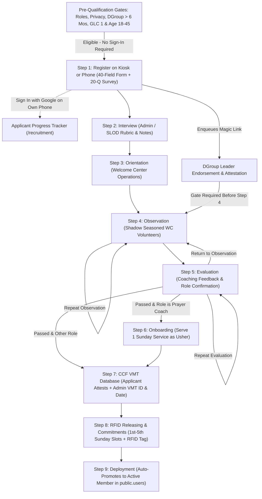
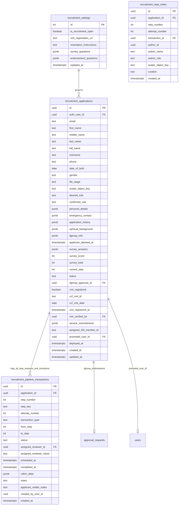
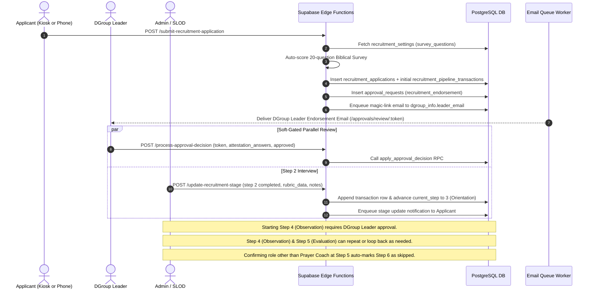

# Volunteer Recruitment Pipeline Roadmap & Phased Implementation Guide

This document defines the architectural blueprint, database schema, backend workflows, frontend specifications, and phased implementation roadmap for the **9-Step Welcome Center Volunteer Recruitment Pipeline** in WelcomeHub.

---

## Phase Summary & Progress Tracker

> **Status Legend**: `⬜ Not Done` · `🔄 In Progress` · `✅ Complete`

| Phase                                                                                         | Milestone                                                                         | Target Layer / Surface                                                                       | Key Deliverables                                                                                                                                                                                                                                                                                                                                                                                                                             |   Status    |
| :-------------------------------------------------------------------------------------------- | :-------------------------------------------------------------------------------- | :------------------------------------------------------------------------------------------- | :------------------------------------------------------------------------------------------------------------------------------------------------------------------------------------------------------------------------------------------------------------------------------------------------------------------------------------------------------------------------------------------------------------------------------------------- | :---------: |
| **[Phase 1](#phase-1-database-schema-seeded-20-question-survey--approval-extension)**         | **Database Schema, `vmt` Role, Seeded Questions & Approval RPCs**                 | `supabase/migrations/`                                                                       | `vmt` auth role, `is_recruitment_reviewer()`, `recruitment_settings` (20 Doctrinal Survey + 25 DGroup Endorsement `DynamicFieldLike` questions), `recruitment_applications`, `recruitment_pipeline_transactions`, `approval_entity_type` extension, & `deploy_recruitment_applicant` RPC                                                                                                                                                     | ✅ Complete |
| **[Phase 2](#phase-2-backend-edge-functions--deno-unit-tests)**                               | **Backend Edge Functions & Notifications**                                        | `supabase/functions/`                                                                        | `submit-recruitment-application`, `update-recruitment-stage` (Steps 1–8, repeatable Steps 4/5, endorsement gate), `deploy-recruitment-applicant` (Admin/SLOD only), extended `process-approval-decision`, & Deno unit tests                                                                                                                                                                                                                  | ✅ Complete |
| **[Phase 3](#phase-3-domain-layer-srclibdomainrecruitment--hooks-srchooksdomainrecruitment)** | **Frontend Domain Layer & React Query Hooks**                                     | `src/lib/domain/recruitment/`, `src/hooks/domain/recruitment/`                               | Strict TypeScript types (`AdminRole` with `'vmt'`, `RECRUITMENT_ROLES` excluding `'OIC'`), Zod schemas, Edge/Supabase API functions, & single-file React Query hooks                                                                                                                                                                                                                                                                         | ✅ Complete |
| **[Phase 4](#phase-4-applicant-self-service-portal-recruitment--dgroup-leader-review-ui)**    | **Kiosk Application Wizard, Own-Phone Progress Portal & DGroup Leader Review UI** | `/recruitment/apply`, `/recruitment`, `/approvals/review/:token`, `/`                        | Hub recruitment banner, 4 Pre-Gates + Kiosk-friendly Step 1 form (`DynamicFieldRenderer` for 20-Q Doctrinal Survey), Own-Phone Google Sign-In 9-Step Progress Tracker, Sunday Commitment Picker, & 25-field DGroup Leader Attestation UI                                                                                                                                                                                                     | ✅ Complete |
| **[Phase 5](#phase-5-admin-slod--vmt-recruitment-pipeline-adminrecruitment--settings)**       | **Admin, SLOD & VMT Recruitment Pipeline & Settings UI**                          | `/admin/recruitment`, `/admin/settings/recruitment`, `/admin/settings`, `/admin/users/roles` | `AdminPageShell` 42-column pipeline table/cards & CSV export, 5-tab review modal (9-Step Pipeline, Survey, DGroup Endorsement, 40-field Profile, & Transaction History), repeatable Steps 4/5, Step 7 `ccf_vmt_id`/`ccf_vmt_date`, Step 8 RFID, Step 9 Deploy, Archive lifecycle, confirmation modals, mobile scrollbar/gutter ergonomics, `AdminBaseNavigation` Recruitment tab, `/admin/settings` Launchpad card, & tabbed settings editor | ✅ Complete |

### Phase Checklist

- [x] **Phase 1: Database Schema, Seeded 20-Question Survey & Approval Extension**
  - [x] Add `'vmt'` role to `public.admins` check constraint & create `public.is_recruitment_reviewer()` / `public.is_admin_or_slod()` helpers
  - [x] Create `public.recruitment_settings` seeded with 20 Doctrinal Survey & 25 DGroup Endorsement `DynamicFieldLike` questions + `public.get_public_recruitment_config()` RPC
  - [x] Create `public.recruitment_applications`, `public.recruitment_pipeline_transactions`, & `public.recruitment_application_latest_schedules_view` (`security_invoker = true`) with strict RLS
  - [x] Extend `public.approval_entity_type` with `'recruitment_endorsement'` and create `public.get_my_recruitment_application()` & `public.deploy_recruitment_applicant()` RPCs
- [x] **Phase 2: Backend Edge Functions & Deno Unit Tests**
  - [x] Implement `submit-recruitment-application` Edge Function + Deno unit tests
  - [x] Implement `update-recruitment-stage` Edge Function + Deno unit tests
  - [x] Implement `deploy-recruitment-applicant` Edge Function + Deno unit tests
  - [x] Extend `process-approval-decision` Edge Function for `recruitment_endorsement` + Deno unit tests
- [x] **Phase 3: Domain Layer (`src/lib/domain/recruitment/`) & Hooks (`src/hooks/domain/recruitment/`)**
  - [x] Extend `AdminRole` with `'vmt'` in `src/lib/domain/auth/types.ts` and role management UI
  - [x] Create `constants.ts`, `types.ts`, `schemas.ts`, `api.ts`, and barrel `index.ts` in `src/lib/domain/recruitment/` + Vitest schema tests
  - [x] Add admin-only `update-recruitment-settings` Edge Function and Deno tests to preserve the Edge-Functions-only write rule
  - [x] Create single-file React Query hooks in `src/hooks/domain/recruitment/`
- [x] **Phase 4: Applicant Self-Service Portal (`/recruitment`) & DGroup Leader Review UI**
  - [x] Add `RecruitmentHubBanner` to WelcomeHub home page (`src/pages/home/`)
  - [x] Build Kiosk-friendly `/recruitment/apply` (4 Pre-Qualification Gates + 5-Section Step 1 Wizard + Kiosk Auto-Reset Screen)
  - [x] Build Own-Phone `/recruitment` 9-Step Progress Tracker (Google OAuth matched by email, Step 7 VMT self-attestation, Step 8 Sunday Commitment Picker)
  - [x] Build `RecruitmentEndorsementReviewSection` in `/approvals/review/:token` using `DynamicFieldRenderer` + Vitest component tests
- [x] **Phase 5: Admin, SLOD & VMT Recruitment Pipeline (`/admin/recruitment`) & Settings (`/admin/settings/recruitment`)**
  - [x] Add `Recruitment` link to `AdminBaseNavigation` for authorized reviewers (`admin`, `super_admin`, `slod`, `vmt`)
  - [x] Build `AdminRecruitmentPage` (`/admin/recruitment`) with `AdminPageShell`, `ListTable`, `MobileCard`, `useInfiniteScrollTrigger`, & 42-column CSV export
  - [x] Build 5-tab `RecruitmentApplicantDetailDialog` (9-Step Pipeline, Doctrinal Survey Breakdown, DGroup Endorsement Review, 40-Field Applicant Profile, and Transaction History with full lifecycle archiving/restoring)
  - [x] Build Confirmation Modals (`ScheduleSessionConfirmDialog`, `CompleteStepConfirmDialog`, `ArchiveApplicantConfirmDialog`) with theme-safe destructive/danger styling
  - [x] Mobile & Dialog Ergonomics: Single scrollbar architecture, sticky dialog headers/footers, 16px mobile gutters (`Dialog.tsx`), and full-width footer action buttons on mobile
  - [x] Synchronize DGroup Endorsement approval status across Step 1, Step 4 gate, Applicant Profile, and Endorsement Review tab
  - [x] Collaborative Recruiter Notes: `public.recruitment_step_notes` multi-entry thread tracking author ID, reviewer name, role, avatar, and timestamp per step without overwriting notes history
  - [x] Applicant Photo Upload & Migration: Device camera/file upload in registration Section 1 (`ApplicantAvatarPicker`), preview in Section 5 (`ApplicantVerificationSection`), reviewer photo editing in Applicant Profile (`EditableApplicantAvatar`), and automated migration of `avatar_object_key` to `public.users` in `deploy_recruitment_applicant`
  - [x] Integrate Recruitment Settings into `/admin/settings` Launchpad (`System Configuration` card) & build tabbed `AdminRecruitmentSettingsPage` (`/admin/settings/recruitment`) + Vitest component tests

---

## 1. Executive Summary & Domain Overview

### 1.1 The 9-Step Recruitment Lifecycle

WelcomeHub supports end-to-end volunteer recruitment from initial registration and biblical survey through DGroup Leader endorsement, interview, orientation, observation, evaluation, role-conditional onboarding, external CCF VMT registration, RFID releasing with Sunday service commitments, and final deployment into an active WelcomeHub Member (`public.users`).



### 1.2 Core Business Rules & Design Decisions

1. **Authorized Kiosk Application & Email-Matched Progress Portal**:

- **Staff-Authenticated Application Intake (`/recruitment/apply`)**: The route and submit Edge Function require a valid JWT and an account with the `admin`, `super_admin`, `kiosk`, or `vmt` role. Applicants do not need their own account, but intake must run on a device signed in to one of these authorized roles. `supabase/config.toml` sets `verify_jwt = true` for the submit function. Prospective applicants first pass a 4-part **Pre-Qualification Gate (`RecruitmentPreGateWizard`)**:
  - **Gate 1 — Role Descriptions, GLC Level 1 & Acknowledgment**: Displays available Welcome Center roles (`Prayer Coach`, `Usher`, `VMT Support`, `IMT Support`, `Backroom Support`) with their responsibilities, then requires separate confirmations that the applicant understands the roles and has completed GLC Level 1 (Book 1 to 4).
  - **Gate 2 — Data Privacy & Waiver**: Displays the CCF WC Ministry data privacy and liability waiver notice and requires _"I agree"_.
  - **Gate 3 — DGroup Attendance (> 6 Months)**: Asks _"I am a part of a DGroup and constantly attending for more than 6 months."_ (`Yes` / `No`). Requires `Yes` to proceed.
  - **Gate 4 — Demographics (18–45 Years Old)**:
    - **Age range (`18 to 45 years old`, `46 to 59 years old (currently closed)`, `60 years old and up (currently closed)`)**: Currently, only **`18 to 45 years old`** is open for recruitment; closed age brackets are rendered disabled in the dropdown.
- Passing all 4 pre-gates proceeds **directly into Step 1 (Registration & 20-Question Biblical Survey)** without requiring the applicant's personal Google Sign-In. After submitting on an authorized kiosk, a completion card displays a link for the applicant and a **"Start New Application"** reset for the next walk-in volunteer.
- **Check Progress on Their Own Phone (`/recruitment`)**: Whenever an applicant wants to view their live 9-step progress (or complete Step 7 VMT confirmation / Step 8 Sunday commitments) on their personal phone, they sign in via Google OAuth using the **same email address** entered in Step 1 (`lower(email) = lower(auth.jwt() ->> 'email')`), which automatically links `auth_user_id` to their application.
- Step 1 form validation and `submit-recruitment-application` enforce `18 <= Age <= 45` (derived from `DOB`), `GLC 1 Course Status === 'Completed'`, and `DGroup Member Since` $\ge 6$ months.

1. **Personal, Emergency, Spiritual, GLC & DGroup Background (40-Field Canonical Schema)**:
   - Captures the full Welcome Center recruitment dataset:
     - **Identity & Demographics**: `First Name`, `Middle Name`, `Last Name`, `Nickname`, `DOB`, `Age` (derived from `DOB`), `Mobile Number`, `Email`, `Gender`, `Life Stage`, `Wedding Anniversary` (conditional on `Married`), `Occupation`, `Company Name`.
     - **Emergency Contact**: `Emergency Contact Name`, `Emergency Contact Number`, `Relation to the Applicant`.
   - **CCF, GLC & Application History**: `CCF Member Since (YYYY MMM)` (with derived tenure in years), `Other Ministries`, `GLC 1 Course Status`, and `GLC 2 Course Status` (shown and required only when GLC 1 is completed), `I have applied in the Welcome Center before`, and `What happened to previous application?` (conditional when checked).
   - **DGroup Membership & Leadership**: `Constant DGroup Attendee?`, `DGroup Member Since (YYYY MMM)` (with derived tenure in years), `Name of DGroup Leader`, `Email of DGroup Leader`, `Mobile of DGroup Leader`, optional `DGroup Leader Since (YYYY MMM)` (with derived tenure in years), and optional `How many members do you have?`. Providing Leader Since derives the internal `is_dgroup_leader` flag.
   - **Pipeline & Schedule Tracking (Transactional History Table)**: `Role`, `Status`, `Attestation`, `Endorsement Info`, `Started On`, `Scheduled Interview On`, `Scheduled Orientation On`, `Scheduled Observation On`, `Scheduled Evaluation On`, and `Scheduled Operations Onboarding On`. All step schedules, coaching sessions, and back-and-forth transitions (e.g., repeating Step 4 Observation and Step 5 Evaluation as many times as needed) are stored in a dedicated transaction table (`public.recruitment_pipeline_transactions`).
2. **20-Question True/False Biblical Survey**:
   - Seeded in `public.recruitment_settings` and editable by Admins in `/admin/settings/recruitment`.
   - Automatically scored upon submission and displayed to Interviewers as a reference/discussion guide during Step 2 (does not auto-reject applicants).
3. **DGroup Leader Endorsement & Attestation (Soft Gate)**:
   - Submitting Step 1 creates an `approval_requests` record (`entity_type: 'recruitment_endorsement'`) and dispatches a tokenized magic-link email to `dgroup_info.leader_email`.
   - The DGroup Leader completes the attestation questionnaire and approves/declines at `/approvals/review/:token` without requiring an account.
   - **Endorsement Gate Before Step 4**: Steps 2 (Interview) and 3 (Orientation) can proceed in parallel while endorsement is pending, but the DGroup Leader Endorsement and Attestation must be `approved` before the applicant can start **Step 4 (Observation)**.
4. **Role Determination & Conditional Step 6 (Onboarding)**:
   - Applicants select a `desired_role` in Step 1 from `RECRUITMENT_ROLES` (`Prayer Coach`, `Usher`, `Backroom Support`, `IMT Support`, `VMT Support` — strictly excluding `OIC`), which Interviewers/Evaluators can adjust or finalize (`confirmed_role`) up to Step 5 (Evaluation).
   - **Step 6 (Onboarding — Serve 1 Sunday Service as Usher)** is required **only** when `confirmed_role === 'Prayer Coach'`. For all other roles, Step 6 is automatically marked `skipped` and the applicant advances directly from Step 5 to Step 7.
5. **External CCF VMT Registration (Step 7)**:
   - Applicants click the external CCF VMT Database registration link on their `/recruitment` portal and self-attest completion (`vmt_registered = true`).
   - Admins/SLODs can record and verify the applicant's external VMT registration details by filling out `ccf_vmt_id` and `ccf_vmt_date` in Step 7.
6. **RFID Releasing & Sunday Service Commitments (Step 8)**:
   - Applicants select their recurring Sunday Service commitments (`1st Sunday` through `5th Sunday` across `9AM`, `12NN`, `3PM`) directly in their `/recruitment` portal.
   - Admins/SLODs review the commitments and assign the physical RFID tag (`assigned_rfid_member_id`) during RFID releasing.
7. **Automated Member Promotion at Deployment (Step 9)**:
   - Finalizing Step 9 atomically creates/activates the volunteer's record in `public.users` with `member_id = assigned_rfid_member_id`, `role = confirmed_role`, `category`, and `metadata` (`first_sunday`–`fifth_sunday`), automatically triggering `users_snapshot_commitment_metadata` into `public.user_commitment_history`.

### 1.3 Administrative Role Permissions Matrix (RBAC)

We introduce a dedicated **`vmt`** auth role (`AdminRole`: `'admin' | 'super_admin' | 'slod' | 'vmt' | 'imt' | 'kiosk'`, assignable by `super_admin` at `/admin/users/roles`) with the same recruitment pipeline access as `slod`, **except** triggering final Step 9 Deployment to the Welcome Center (`public.users`).

| Capability / Surface                                                                               | `super_admin` & `admin` |      `slod`       |          `vmt`           |     `kiosk`     | `imt` | Applicant (Own Phone)  |
| :------------------------------------------------------------------------------------------------- | :---------------------: | :---------------: | :----------------------: | :-------------: | :---: | :--------------------: |
| **Authorized Application Intake (`/recruitment/apply`)**                                           |           ✅            |        ❌         |            ✅            | ✅ (Kiosk Mode) |  ❌   |           ❌           |
| **Personal 9-Step Progress Tracker (`/recruitment`)**                                              |           ✅            |        ✅         |            ✅            |       ❌        |  ❌   | ✅ (Matched by Email)  |
| **View Recruitment Pipeline & 42-Column Table (`/admin/recruitment`)**                             |           ✅            |        ✅         |            ✅            |       ❌        |  ❌   |           ❌           |
| **View 20-Question Biblical Survey Score & Answers**                                               |           ✅            |        ✅         |            ✅            |       ❌        |  ❌   | ❌ _(Hidden via RLS)_  |
| **View Internal Interviewer & Coaching Notes / Rubrics**                                           |           ✅            |        ✅         |            ✅            |       ❌        |  ❌   | ❌ _(Hidden via RLS)_  |
| **View DGroup Leader Endorsement & Resend Endorsment Link**                                        |           ✅            |        ✅         |            ✅            |       ❌        |  ❌   | ✅ _(Status + Resend)_ |
| **Delegate Endorsement Review in `/admin/approvals`**                                              |           ✅            |  Assigned items   |      Assigned items      |       ❌        |  ❌   |           ❌           |
| **Schedule & Conduct Step 2 (Interview) & Step 3 (Orientation)**                                   |           ✅            |        ✅         |            ✅            |       ❌        |  ❌   |           ❌           |
| **Schedule, Repeat, or Loop Step 4 (Observation) & Step 5 (Evaluation)**                           |           ✅            |        ✅         |            ✅            |       ❌        |  ❌   |           ❌           |
| **Schedule & Complete Step 6 (Prayer Coach Usher Onboarding)**                                     |           ✅            |        ✅         |            ✅            |       ❌        |  ❌   |           ❌           |
| **Override DGroup Leader Endorsement Gate (Before Step 4)**                                        |           ✅            | ❌ _(Admin only)_ |    ❌ _(Admin only)_     |       ❌        |  ❌   |           ❌           |
| **Self-Attest External CCF VMT Registration (Step 7)**                                             |           ✅            |        ✅         |            ✅            |       ❌        |  ❌   |           ✅           |
| **Fill Out Step 7 (`ccf_vmt_id` & `ccf_vmt_date`)**                                                |           ✅            |        ✅         |            ✅            |       ❌        |  ❌   |           ❌           |
| **Select 1st–5th Sunday Service Commitments (Step 8)**                                             |           ✅            |        ✅         |            ✅            |       ❌        |  ❌   |           ✅           |
| **Assign Physical RFID Tag (`assigned_rfid_member_id`) in Step 8**                                 |           ✅            |        ✅         |            ✅            |       ❌        |  ❌   |           ❌           |
| **Trigger Step 9 Deployment (Promote to `public.users`)**                                          |           ✅            |        ✅         | ❌ _(Admin / SLOD only)_ |       ❌        |  ❌   |           ❌           |
| **Export Recruitment CSV (`/admin/recruitment`)**                                                  |           ✅            |        ✅         |            ✅            |       ❌        |  ❌   |           ❌           |
| **Manage Recruitment Settings, Eligibility & 20 Survey Questions (`/admin/settings/recruitment`)** |           ✅            | ❌ _(Admin only)_ |    ❌ _(Admin only)_     |       ❌        |  ❌   |           ❌           |

#### Role Scope Summary

1. **`super_admin` & `admin` (Full Control)**:
   - Manage the entire `/admin/recruitment` pipeline (Steps 1–9), export CSVs, override the DGroup Leader endorsement gate when pastorally necessary, and configure `/admin/settings/recruitment` (open/close recruitment, age bracket rules, 20 Biblical Survey questions, and DGroup Leader attestation prompts).
2. **`slod` (Pipeline Operations, Interviewing, Coaching & Final Deployment)**:
   - Access `/admin/recruitment` to view applicants, inspect their 20-question Biblical Survey breakdown, schedule and record sessions for **Interview (Step 2)**, **Orientation (Step 3)**, **Observation (Step 4)**, **Evaluation (Step 5)**, and **Onboarding (Step 6)**, record `ccf_vmt_id` / `ccf_vmt_date` (Step 7), assign RFID (Step 8), and trigger **Step 9 Deployment** into `public.users`.
   - Cannot modify global recruitment settings or survey questions (`/admin/settings/recruitment`), and cannot bypass the DGroup Leader endorsement gate before Step 4.
3. **`vmt` (Recruitment Pipeline Operations — Steps 1 to 8)**:
   - Identical access to `slod` across `/admin/recruitment` for Steps 1–8 (viewing the 42-column pipeline, exporting CSVs, viewing the 20-question Biblical Survey, scheduling/recording Interviews, Orientations, Observations, Evaluations, and Onboarding, filling out `ccf_vmt_id` and `ccf_vmt_date` in Step 7, and assigning the physical RFID tag in Step 8).
   - **Cannot trigger Step 9 (Deploy to Welcome Center)** — final member promotion to `public.users` requires an `admin`, `super_admin`, or `slod`.
4. **`kiosk` (On-Premise Kiosk Tablet)**:
   - Used on the Welcome Center Kiosk to run `/recruitment/apply` (Pre-Gates + Step 1 Form + Completion & Auto-Reset screen). Has zero access to `/admin/recruitment`.
5. **`imt`**:
   - No access to `/admin/recruitment`.
6. **Applicant (Signed In via Google OAuth on Own Phone)**:
   - Accesses `/recruitment` (matched by `lower(email) = lower(auth.jwt() ->> 'email')`) to view their live 9-step progress timeline, applicant-visible instructions, Step 7 VMT confirmation button, and Step 8 Sunday Service commitment selector.

---

## 2. Detailed Phase Specifications

### Phase 1: Database Schema, Seeded 20-Question Survey & Approval Extension

#### 1.1 Objectives

Establish the database foundation, RLS security model, default 20-question Biblical Survey and DGroup Leader attestation prompts, Unified Approval Workflow integration, and atomic Member promotion logic.

#### 1.2 Database ER Diagram



#### 1.3 Canonical 40-Field Recruitment Data Dictionary

| #   | Field Label                                               | Type / Computation                                | Database Column / JSONB Path                                            | Step / Conditional Rule                                   |
| :-- | :-------------------------------------------------------- | :------------------------------------------------ | :---------------------------------------------------------------------- | :-------------------------------------------------------- |
| 1   | `Role`                                                    | `RecruitmentRole` (`Exclude<ServiceRole, 'OIC'>`) | `desired_role` / `confirmed_role`                                       | Selected in Step 1 (`OIC` excluded); finalized by Step 5  |
| 2   | `Status`                                                  | `RecruitmentApplicationStatus`                    | `status` + `current_step`                                               | Pipeline status & current step (`1..9`)                   |
| 3   | `First Name`                                              | `text` (Required)                                 | `first_name`                                                            | Step 1 — Personal Details                                 |
| 4   | `Middle Name`                                             | `text` (Optional)                                 | `middle_name`                                                           | Step 1 — Personal Details                                 |
| 5   | `Last Name`                                               | `text` (Required)                                 | `last_name`                                                             | Step 1 — Personal Details                                 |
| 6   | `Nickname`                                                | `text` (Required)                                 | `nickname`                                                              | Step 1 — Personal Details                                 |
| 7   | `DOB`                                                     | `date` (Required)                                 | `date_of_birth`                                                         | Step 1 — Personal Details                                 |
| 8   | `Age`                                                     | `number` (Derived)                                | Computed from `date_of_birth`                                           | Derived at render & CSV export                            |
| 9   | `Mobile Number`                                           | `text` (Required)                                 | `phone`                                                                 | Step 1 — Personal Details                                 |
| 10  | `Email`                                                   | `text` (Required)                                 | `email`                                                                 | Entered in Step 1 (matches Google OAuth on own phone)     |
| 11  | `Gender`                                                  | `'Male' \| 'Female'`                              | `gender`                                                                | Step 1 — Personal Details                                 |
| 12  | `Attestation`                                             | `boolean` / `timestamptz`                         | `applicant_attested_at`                                                 | Step 1 — Applicant Attestation                            |
| 13  | `Endorsement Info`                                        | `ApprovalStatus` + JSONB                          | `dgroup_approval_id` (`approval_requests`)                              | DGroup Leader approval status & attestation               |
| 14  | `Scheduled Orientation On`                                | `timestamptz` (Latest session)                    | `recruitment_pipeline_transactions` (`step_number = 3`, `scheduled_at`) | Step 3 — Orientation (supports multiple sessions)         |
| 15  | `Scheduled Evaluation On`                                 | `timestamptz` (Latest session)                    | `recruitment_pipeline_transactions` (`step_number = 5`, `scheduled_at`) | Step 5 — Evaluation (repeatable with Step 4)              |
| 16  | `Scheduled Observation On`                                | `timestamptz` (Latest session)                    | `recruitment_pipeline_transactions` (`step_number = 4`, `scheduled_at`) | Step 4 — Observation (repeatable as needed)               |
| 17  | `Scheduled Interview On`                                  | `timestamptz` (Latest session)                    | `recruitment_pipeline_transactions` (`step_number = 2`, `scheduled_at`) | Step 2 — Interview (supports rescheduling)                |
| 18  | `Scheduled Operations Onboarding On`                      | `timestamptz` (Latest session)                    | `recruitment_pipeline_transactions` (`step_number = 6`, `scheduled_at`) | Step 6 — Operations Onboarding (Prayer Coach)             |
| 19  | `Started On`                                              | `timestamptz`                                     | `created_at`                                                            | Timestamp when Step 1 was submitted                       |
| 20  | `Constant DGroup Attendee?`                               | `boolean`                                         | `dgroup_info.is_constant_attendee`                                      | Step 1 — DGroup Details (`Yes` / `No`)                    |
| 21  | `GLC 1 Course Status`                                     | `text`                                            | `spiritual_background.glc1_status`                                      | Step 1 — Spiritual & GLC (`Completed`, `Ongoing`, `None`) |
| 22  | `GLC 2 Course Status`                                     | `text` (Conditional)                              | `spiritual_background.glc2_status`                                      | Required only when GLC 1 is `Completed`                   |
| 23  | `Is this your first time to apply in the Welcome Center?` | `boolean`                                         | `application_history.is_first_time_applicant`                           | Step 1 — Application History (`Yes` / `No`)               |
| 24  | `What happened to previous application?`                  | `text` (Conditional)                              | `application_history.previous_application_notes`                        | Required when `is_first_time_applicant === false`         |
| 25  | `Life Stage`                                              | `text` (Required)                                 | `life_stage` (maps to `users.category` on deploy)                       | Step 1 — Personal Details                                 |
| 26  | `Wedding Anniversary`                                     | `date` (Conditional)                              | `personal_details.wedding_anniversary`                                  | Shown when `life_stage === 'Married'`                     |
| 27  | `Occupation`                                              | `text` (Required)                                 | `personal_details.occupation`                                           | Step 1 — Personal & Work Details                          |
| 28  | `Company Name`                                            | `text` (Optional)                                 | `personal_details.company_name`                                         | Step 1 — Personal & Work Details                          |
| 29  | `Emergency Contact Name`                                  | `text` (Required)                                 | `emergency_contact.name`                                                | Step 1 — Emergency Contact                                |
| 30  | `Emergency Contact Number`                                | `text` (Required)                                 | `emergency_contact.phone`                                               | Step 1 — Emergency Contact                                |
| 31  | `Relation to the Applicant`                               | `text` (Required)                                 | `emergency_contact.relation`                                            | Step 1 — Emergency Contact                                |
| 32  | `CCF Member Since (YYYY MMM)`                             | `text` (`YYYY-MM` + derived yrs)                  | `spiritual_background.ccf_member_since`                                 | Step 1 — Spiritual & CCF Background                       |
| 33  | `Other Ministries`                                        | `text` (Optional)                                 | `spiritual_background.other_ministries`                                 | Step 1 — Spiritual & CCF Background                       |
| 34  | `DGroup Member Since (YYYY MMM)`                          | `text` (`YYYY-MM` + derived yrs)                  | `dgroup_info.member_since`                                              | Step 1 — DGroup Details                                   |
| 35  | `Name of DGroup Leader`                                   | `text` (Required)                                 | `dgroup_info.leader_name`                                               | Step 1 — DGroup Details                                   |
| 36  | `Email of DGroup Leader`                                  | `text` (Required)                                 | `dgroup_info.leader_email`                                              | Step 1 — DGroup Details (magic-link recipient)            |
| 37  | `Mobile of DGroup Leader`                                 | `text` (Required)                                 | `dgroup_info.leader_phone`                                              | Step 1 — DGroup Details                                   |
| 38  | `DGroup Leader Status`                                    | `boolean` (Derived)                               | `dgroup_info.is_dgroup_leader`                                          | `true` when `leader_since` is provided                    |
| 39  | `DGroup Leader Since (YYYY MMM)`                          | `text` (`YYYY-MM` + derived yrs, Optional)        | `dgroup_info.leader_since`                                              | Step 1 — DGroup Details                                   |
| 40  | `How many members do you have?`                           | `number` (Optional)                               | `dgroup_info.dgroup_member_count`                                       | Step 1 — DGroup Details                                   |
| 41  | `CCF VMT ID`                                              | `text` (Admin Input)                              | `ccf_vmt_id`                                                            | Step 7 — External CCF VMT Registration                    |
| 42  | `CCF VMT Date`                                            | `date` (Admin Input)                              | `ccf_vmt_date`                                                          | Step 7 — External CCF VMT Registration                    |

#### 1.4 Migration Deliverables (`supabase/migrations/`)

1. **New `'vmt'` Auth Role & Helper Functions (`public.is_recruitment_reviewer()` & `public.is_admin_or_slod()`)**:
   - Extend `public.admins.role` check constraint to allow `'vmt'` (`'super_admin'`, `'admin'`, `'slod'`, `'vmt'`, `'imt'`, `'kiosk'`) so `super_admin` users can assign the `vmt` role at `/admin/users/roles`.
   - `public.is_recruitment_reviewer()` (`SECURITY DEFINER`, `search_path = public`): Returns `true` if the authenticated user has role `'super_admin'`, `'admin'`, `'slod'`, or `'vmt'` in `public.admins`. Used for all `/admin/recruitment` read/write operations across **Steps 1 to 8**.
   - `public.is_admin_or_slod()` (`SECURITY DEFINER`, `search_path = public`): Returns `true` if the authenticated user has role `'super_admin'`, `'admin'`, or `'slod'` in `public.admins`. Required specifically to execute **Step 9: Deploy to Welcome Center (`public.deploy_recruitment_applicant`)**.
2. **Table `public.recruitment_settings` & Public Config RPC (`get_public_recruitment_config`)**:
   - Singleton row (`id = 1`, enforced via `check (id = 1)`).
   - Both `survey_questions` and `endorsement_questions` conform directly to `DynamicFieldLike` (`src/lib/domain/dynamic-fields/types.ts`) so they render via `DynamicFieldRenderer` (`src/components/fields/DynamicFieldRenderer.tsx`), validate via `buildDynamicFieldResponseSchema` (`src/lib/domain/dynamic-fields/validation.ts`), and use `DynamicFieldTypeSelector` + `DynamicFieldValidationRulesSection` in `/admin/settings/recruitment`:
     - **`survey_questions` (`RecruitmentSurveyFieldItem[] extends DynamicFieldLike` — 20 Seeded Doctrinal Survey Questions)**:
       - Seeded with the 20 official **Doctrinal Survey** `radio` (`[{ label: 'True', value: 'true' }, { label: 'False', value: 'false' }]`) `DynamicFieldLike` items, plus `correct_answer` (`'true' | 'false'`) and `explanation` (`string`) for auto-scoring and Step 2 Interviewer guidance:

         ```json
         {
           "id": "sq_1",
           "field_key": "survey_q1",
           "label": "Jesus Christ is God.",
           "field_type": "radio",
           "is_required": true,
           "is_active": true,
           "display_order": 1,
           "options": [
             { "label": "True", "value": "true" },
             { "label": "False", "value": "false" }
           ],
           "correct_answer": "true",
           "explanation": "John 1:1, 10:30, Colossians 2:9"
         }
         ```

| #   | `field_key`  | Doctrinal Survey Statement (`label`)                                                                                                | `field_type`               | `correct_answer` | Correct Statement / Interviewer Guide (`explanation`)                                                                            |
| :-- | :----------- | :---------------------------------------------------------------------------------------------------------------------------------- | :------------------------- | :--------------: | :------------------------------------------------------------------------------------------------------------------------------- |
| 1   | `survey_q1`  | `Jesus Christ is God.`                                                                                                              | `radio` (`True` / `False`) |      `true`      | `Jesus Christ is God.`                                                                                                           |
| 2   | `survey_q2`  | `Salvation is given by God's grace and can not be earned by man through good works, baptism, church membership or any other means.` | `radio` (`True` / `False`) |      `true`      | `Salvation is given by God's grace and cannot be earned through good works, baptism, or church membership.`                      |
| 3   | `survey_q3`  | `Salvation means that the believer will no longer commit any sin.`                                                                  | `radio` (`True` / `False`) |     `false`      | `Believers can still commit sin while being sanctified, though they are forgiven in Christ (1 John 1:8–9).`                      |
| 4   | `survey_q4`  | `Jesus is not the only mediator between God and man.`                                                                               | `radio` (`True` / `False`) |     `false`      | `Jesus is THE ONLY mediator between God and man (1 Timothy 2:5).`                                                                |
| 5   | `survey_q5`  | `We can have meaningful life on earth and a sure place in heaven if we are good enough.`                                            | `radio` (`True` / `False`) |     `false`      | `No one is good enough on their own; a meaningful life and a sure place in heaven come only through Jesus Christ.`               |
| 6   | `survey_q6`  | `I will go to heaven if my good deeds outnumber my bad deeds.`                                                                      | `radio` (`True` / `False`) |     `false`      | `We go to heaven by God's grace through faith in Jesus Christ, not by our good deeds outweighing our bad deeds.`                 |
| 7   | `survey_q7`  | `True believers are secure in Christ and no one can snatch them away from the Father's hand.`                                       | `radio` (`True` / `False`) |      `true`      | `True believers are secure in Christ and no one can snatch them away from the Father's hand (John 10:28–29).`                    |
| 8   | `survey_q8`  | `God does not discipline the genuine believers because they are His children.`                                                      | `radio` (`True` / `False`) |     `false`      | `God disciplines genuine believers because He loves them as His children (Hebrews 12:6).`                                        |
| 9   | `survey_q9`  | `Being filled with the Holy Spirit is moment by moment submission to God and His Word.`                                             | `radio` (`True` / `False`) |      `true`      | `Being filled with the Holy Spirit is moment-by-moment submission to God and His Word.`                                          |
| 10  | `survey_q10` | `The Holy Spirit is God, equal with the Father and the Son.`                                                                        | `radio` (`True` / `False`) |      `true`      | `The Holy Spirit is God, equal with the Father and the Son.`                                                                     |
| 11  | `survey_q11` | `The Holy Spirit is not a Person.`                                                                                                  | `radio` (`True` / `False`) |     `false`      | `The Holy Spirit IS a Person (the third Person of the Trinity).`                                                                 |
| 12  | `survey_q12` | `There are no evidences for the reliability and accuracy of the Bible.`                                                             | `radio` (`True` / `False`) |     `false`      | `There ARE strong historical, prophetic, and manuscript evidences for the reliability and accuracy of the Bible.`                |
| 13  | `survey_q13` | `The Bible is the highest and final authority in all things and not religious traditions or human authority.`                       | `radio` (`True` / `False`) |      `true`      | `The Bible is the highest and final authority in all things.`                                                                    |
| 14  | `survey_q14` | `The Church is the genuine believers of Christ and not a place or a building.`                                                      | `radio` (`True` / `False`) |      `true`      | `The Church is the genuine believers of Christ and not a place or a building.`                                                   |
| 15  | `survey_q15` | `Salvation requires membership in the church.`                                                                                      | `radio` (`True` / `False`) |     `false`      | `Salvation does NOT require membership in the church; it is by grace through faith in Christ alone.`                             |
| 16  | `survey_q16` | `Salvation requires water baptism.`                                                                                                 | `radio` (`True` / `False`) |     `false`      | `Salvation does NOT require water baptism; baptism is an outward step of obedience after salvation.`                             |
| 17  | `survey_q17` | `Worship is our proper response to who God is and what He has done through Christ.`                                                 | `radio` (`True` / `False`) |      `true`      | `Worship is our proper response to who God is and what He has done through Christ.`                                              |
| 18  | `survey_q18` | `The Holy Spirit empowers the believer for witnessing.`                                                                             | `radio` (`True` / `False`) |      `true`      | `The Holy Spirit empowers the believer for witnessing (Acts 1:8).`                                                               |
| 19  | `survey_q19` | `Success in witnessing is taking the initiative to share Christ in the power of the Holy Spirit and leaving the results to God.`    | `radio` (`True` / `False`) |      `true`      | `Success in witnessing is taking the initiative to share Christ in the power of the Holy Spirit and leaving the results to God.` |
| 20  | `survey_q20` | `The command to witness is given to all followers of Christ.`                                                                       | `radio` (`True` / `False`) |      `true`      | `The command to witness is given to all followers of Christ (Matthew 28:19–20).`                                                 |

     - **`endorsement_questions` (`DynamicFieldLike[]` — 25 Seeded DGroup Leader Endorsement & Attestation Fields)**:
       - Standard `DynamicFieldLike` array rendered directly via `DynamicFieldRenderer` (`RatingFieldRenderer` / `RadioFieldRenderer` / `TextareaFieldRenderer` / `TextFieldRenderer`) and validated via `buildDynamicFieldResponseSchema` (including `validation_rules.visibility_rule` dependencies):

| #   | `field_key`                       | Field Label                                                                                                                   | `field_type`         | Configuration / Conditional Rule (`validation_rules`)                                                                                                                                                                                                                                                                                                                                                                              |
| :-- | :-------------------------------- | :---------------------------------------------------------------------------------------------------------------------------- | :------------------- | :--------------------------------------------------------------------------------------------------------------------------------------------------------------------------------------------------------------------------------------------------------------------------------------------------------------------------------------------------------------------------------------------------------------------------------- |
| —   | _(Header Context)_                | **Disciple / Applicant Name (`Name1`)**                                                                                       | _(Read-Only Header)_ | Automatically displayed from `recruitment_applications.full_name`                                                                                                                                                                                                                                                                                                                                                                  |
| 1   | `leader_full_name`                | `What is your full name?`                                                                                                     | `text`               | Required (pre-populated from `dgroup_info.leader_name`, editable by leader)                                                                                                                                                                                                                                                                                                                                                        |
| 2   | `disciple_dgroup_since`           | `Please enter when your disciple started in your DGroup (YYYY MMM)`                                                           | `text`               | Required (`YYYY MMM` month/year format, matching Step 1)                                                                                                                                                                                                                                                                                                                                                                           |
| 3   | `is_disciple_dgroup_leader`       | `Is your disciple already a DGroup Leader?`                                                                                   | `radio`              | Required (`Yes` / `No`)                                                                                                                                                                                                                                                                                                                                                                                                            |
| 4   | `disciple_led_dgroup_since`       | `Please enter when your disciple started his/her own DGroup (YYYY MMM)`                                                       | `text`               | Conditional (`visibility_rule: { depends_on_field_key: 'is_disciple_dgroup_leader', equals_value: 'Yes' }`, `YYYY MMM`)                                                                                                                                                                                                                                                                                                            |
| 5   | `eval_prayer_and_devotion`        | `Has consistent prayer time, personal devotion and study of God's word`                                                       | `rating` (`1–3`)     | `min: 1, max: 3` (`1 = Not Observed`, `2 = Observed Some of the time`, `3 = Observed Most of the time`)                                                                                                                                                                                                                                                                                                                            |
| 6   | `eval_private_life_in_order`      | `Private life is in order--free from any form of addictions, uses time and resources wisely`                                  | `rating` (`1–3`)     | `min: 1, max: 3` (`1 = Not Observed`, `2 = Observed Some of the time`, `3 = Observed Most of the time`)                                                                                                                                                                                                                                                                                                                            |
| 7   | `eval_scripture_priorities`       | `Makes decisions and set priorities based on the Scriptures`                                                                  | `rating` (`1–3`)     | `min: 1, max: 3` (`1 = Not Observed`, `2 = Observed Some of the time`, `3 = Observed Most of the time`)                                                                                                                                                                                                                                                                                                                            |
| 8   | `eval_shares_gospel`              | `Shares the gospel consistently`                                                                                              | `rating` (`1–3`)     | `min: 1, max: 3` (`1 = Not Observed`, `2 = Observed Some of the time`, `3 = Observed Most of the time`)                                                                                                                                                                                                                                                                                                                            |
| 9   | `eval_submits_to_authority`       | `Submits to God-given authorities (Government, Church Leaders, Parents, Superiors, etc.)`                                     | `rating` (`1–3`)     | `min: 1, max: 3` (`1 = Not Observed`, `2 = Observed Some of the time`, `3 = Observed Most of the time`)                                                                                                                                                                                                                                                                                                                            |
| 10  | `eval_listens_to_counsel`         | `Listens to corrections and counsel`                                                                                          | `rating` (`1–3`)     | `min: 1, max: 3` (`1 = Not Observed`, `2 = Observed Some of the time`, `3 = Observed Most of the time`)                                                                                                                                                                                                                                                                                                                            |
| 11  | `eval_treats_people_with_respect` | `Treats difficult people with respect and dignity; communicates with tact and due diligence`                                  | `rating` (`1–3`)     | `min: 1, max: 3` (`1 = Not Observed`, `2 = Observed Some of the time`, `3 = Observed Most of the time`)                                                                                                                                                                                                                                                                                                                            |
| 12  | `eval_no_gossip`                  | `Does not criticize, judge, badmouth, nor gossip about other people`                                                          | `rating` (`1–3`)     | `min: 1, max: 3` (`1 = Not Observed`, `2 = Observed Some of the time`, `3 = Observed Most of the time`)                                                                                                                                                                                                                                                                                                                            |
| 13  | `eval_consistent_small_group`     | `Consistently leads and/or attends a small group`                                                                             | `rating` (`1–3`)     | `min: 1, max: 3` (`1 = Not Observed`, `2 = Observed Some of the time`, `3 = Observed Most of the time`)                                                                                                                                                                                                                                                                                                                            |
| 14  | `eval_serves_others`              | `Serves others even when inconvenient`                                                                                        | `rating` (`1–3`)     | `min: 1, max: 3` (`1 = Not Observed`, `2 = Observed Some of the time`, `3 = Observed Most of the time`)                                                                                                                                                                                                                                                                                                                            |
| 15  | `eval_family_relationships`       | `Maintains good relationship with spouse and/or children, parents and/or siblings (as applicable)`                            | `rating` (`1–3`)     | `min: 1, max: 3` (`1 = Not Observed`, `2 = Observed Some of the time`, `3 = Observed Most of the time`)                                                                                                                                                                                                                                                                                                                            |
| 16  | `eval_quality_family_time`        | `Spends quality time with the family`                                                                                         | `rating` (`1–3`)     | `min: 1, max: 3` (`1 = Not Observed`, `2 = Observed Some of the time`, `3 = Observed Most of the time`)                                                                                                                                                                                                                                                                                                                            |
| 17  | `disciple_strengths`              | `What are the strengths that you see in your disciple?`                                                                       | `textarea`           | Required                                                                                                                                                                                                                                                                                                                                                                                                                           |
| 18  | `disciple_weaknesses`             | `What are the weaknesses that you see in your disciple?`                                                                      | `textarea`           | Required                                                                                                                                                                                                                                                                                                                                                                                                                           |
| 19  | `disciple_improvements`           | `What can be improved on? How?`                                                                                               | `textarea`           | Required                                                                                                                                                                                                                                                                                                                                                                                                                           |
| 20  | `credibility_concerns`            | `Is there anything currently that may impact your disciple's effectiveness and credibility in serving in the Welcome Center?` | `multi_select`       | Optional (`help_text: "Kindly check all that is appropriate, you may leave this blank if you do not see any impact"`). Options: `Marriage and Family Issues`, `Divorce or Separation`, `Past Indiscretions`, `Immorality (Adultery, Fornication, Pornography, etc)`, `Homosexuality`, `Financial Issues`, `Questionable Business Dealings`, `Church Conflict`, `Questionable Reputation in the Community`, `Legal Issues`, `Other` |
| 21  | `credibility_concerns_details`    | `Briefly describe why you choose the concerns above (if any)`                                                                 | `textarea`           | Required (`help_text: "Write N/A if you did not choose any concerns above."`)                                                                                                                                                                                                                                                                                                                                                      |
| 22  | `recommendation_decision`         | `Based on your previous feedback, would you recommend your disciple to volunteer to serve in the Welcome Center ministry?`    | `radio`              | Required (`Yes` / `Yes, with reservations` / `No (Not at this time)`)                                                                                                                                                                                                                                                                                                                                                              |
| 23  | `recommendation_comments`         | `Write any comment that is significant based on your recommendation.`                                                         | `textarea`           | Optional                                                                                                                                                                                                                                                                                                                                                                                                                           |
| 24  | `leader_attestation_statement`    | `The following statements are for your disciple (12-point disciple attestation & leader commitment — see full text below)`    | `radio`              | Required (`I attest` / `I DO NOT attest`)                                                                                                                                                                                                                                                                                                                                                                                          |
| 25  | `attestation_comments`            | `Write any comments that is significant based on your attestation.`                                                           | `textarea`           | Optional                                                                                                                                                                                                                                                                                                                                                                                                                           |

- **Full Text of `#24 (leader_attestation_statement)`**:

  > **The following statements are for your disciple.**
  >
  > 1. Is a committed member of my DGroup.
  > 2. Saved by grace through faith in Jesus and experiencing life transformation.
  > 3. Pursues spiritual disciplines such as consistent prayer and quiet time.
  > 4. Does his/her best to honor God through a daily lifestyle that is above reproach and does not indulge in worldly pleasures and gossiping.
  > 5. Practices sexual purity and forgiveness.
  > 6. Not involved in a romantic relationship with an unbeliever.
  > 7. Manages his/her finances well by minimizing debt and tithing regularly.
  > 8. Does his/her best to live a life of integrity in public, private, and social media.
  > 9. Have a teachable and humble heart, open to accountability and correction by his/her DGroup and ministry leader.
  > 10. Wants to be used by God to disciple others and help to disciple others.
  > 11. Finished GLC 1 and/or attended a True Life Retreat. If in case he/she has not finished GLC 1 yet, He/she commits to finishing GLC 1 within the year and allows his/her Dleader or District Head to monitor his/her progress.
  > 12. Knows by heart CCF's mission and vision.
  >
  > **I commit to supporting my disciple by regularly praying for, mentoring, and checking up on him/her as he/she volunteers in the Welcome Center throughout the year. I also consent to be contacted by the Welcome Center leadership to discuss the growth and walk of my disciple as the need arises throughout the volunteer period.**
  >
  > - Options: `I attest` / `I DO NOT attest`

- **RLS (Answer-Key Protection)**:
  - Direct `SELECT` on `public.recruitment_settings` is restricted strictly to `public.is_recruitment_reviewer()` so `anon` and `authenticated` applicants cannot inspect `survey_questions[].correct_answer` or `explanation` in browser DevTools.
  - Direct `UPDATE` is restricted to `public.is_admin()`.
  - Public/Kiosk and applicant views call `public.get_public_recruitment_config()` (`SECURITY DEFINER`, `search_path = public`), which returns `is_recruitment_open`, `eligibility_rules`, `vmt_registration_url`, `orientation_instructions`, and `survey_questions` mapped strictly to `DynamicFieldLike` (stripping `correct_answer` and `explanation`).

1. **Table `public.recruitment_applications`**:
   - Tracks applicant profile, `desired_role`, `confirmed_role`, `spiritual_background`, `dgroup_info`, `survey_answers`, `survey_score`, `survey_total`, `current_step` (`1..9`), `status` (`'active' | 'archived' | 'deployed' | 'declined' | 'withdrawn'`), `dgroup_approval_id`, `vmt_registered`, `ccf_vmt_id`, `ccf_vmt_date`, `service_commitments`, `assigned_rfid_member_id`, and `promoted_user_id`.
   - **RLS**:
     - `anon` (Public / Kiosk): **Zero direct table access** (`NO` `SELECT`, `INSERT`, `UPDATE`, or `DELETE` policy). Kiosk submissions go exclusively through the `submit-recruitment-application` Edge Function (`service_role`), preventing anyone on a shared Kiosk from querying or enumerating applications.
     - `authenticated` (Applicant on Own Phone):
       - Can `SELECT` their own row when `auth_user_id = auth.uid()` **OR** `lower(email) = lower(coalesce(auth.jwt() ->> 'email', ''))` (matching the `/profile` pattern on `public.users`).
       - **Zero direct `UPDATE` or `DELETE` policies** for applicants — all applicant self-service updates (Step 7 VMT confirmation, Step 8 Sunday commitments, Resend Endorsement) go through validated RPCs/Edge Functions so applicants cannot tamper with `current_step`, `status`, `confirmed_role`, or `survey_score`.
     - `authenticated` (Admins, SLODs & VMT — `public.is_recruitment_reviewer()`): Full `SELECT`, `INSERT`, and `UPDATE` policies for Steps 1–8; final transition to `status = 'deployed'` / `current_step = 9` is enforced by `public.deploy_recruitment_applicant` (`public.is_admin_or_slod()`).
2. **Transaction Table `public.recruitment_pipeline_transactions` & Schedule View**:
   - **Multi-Session & Back-and-Forth Audit Trail**: Unlike a static 1-row-per-step table, `recruitment_pipeline_transactions` is a transactional log (with no unique constraint on `(application_id, step_number)`), allowing an applicant to be scheduled for Observation (`step_number = 4`) and Evaluated (`step_number = 5`) as many times as needed.
   - **Columns**:
     - `step_number` (`1..9`) and `step_key` (`'register'`, `'interview'`, `'orientation'`, `'observation'`, `'evaluation'`, `'onboarding'`, `'vmt_registration'`, `'rfid_releasing'`, `'deployment'`).
     - `attempt_number` (`int`, auto-incremented per `(application_id, step_number)` — e.g., `Observation #1`, `Evaluation #1`, `Evaluation #2`, `Observation #2`, `Evaluation #3`).
     - `transaction_type` (`'scheduled' | 'rescheduled' | 'completed' | 'repeated_step' | 'returned_to_observation' | 'skipped' | 'archived' | 'restored' | 'declined'`).
     - `from_step` (`int`) and `to_step` (`int`) — explicitly records forward progression (`4 -> 5`), same-step repetition (`4 -> 4` for another Observation or `5 -> 5` for another Evaluation), and coaching loops back to a previous step (`5 -> 4` when an Evaluator determines the applicant needs another Observation session).
     - `scheduled_at` (`timestamptz`), `completed_at` (`timestamptz`), `assigned_reviewer_id`, `assigned_reviewer_name`, `rubric_data`, `notes` (internal), and `applicant_visible_notes`.
   - **RLS & Internal Coaching Note Privacy**:
     - Direct table RLS on `public.recruitment_pipeline_transactions` is restricted **strictly to `public.is_recruitment_reviewer()`** (`admin`, `super_admin`, `slod`, `vmt`) so applicants can never query internal coaching `notes` or `rubric_data`.
     - Signed-in applicants retrieve their own progress timeline via `public.get_my_recruitment_application()` (`SECURITY DEFINER`, `search_path = public`), which verifies `auth_user_id = auth.uid() OR lower(email) = lower(coalesce(auth.jwt() ->> 'email', ''))`, automatically backfills `auth_user_id = auth.uid()` on first sign-in, and returns only safe status fields (`step_number`, `step_key`, `attempt_number`, `status`, `scheduled_at`, `completed_at`, `assigned_reviewer_name`) while strictly excluding `notes`, `rubric_data`, internal `survey_score`, and suppressing custom instructions to prevent accidental information leakage.
   - **Latest Schedule View (`public.recruitment_application_latest_schedules_view`)**:
     - Created `with (security_invoker = true)` (per `AGENTS.md` Rule 3) using `DISTINCT ON (application_id, step_number) ... ORDER BY created_at DESC` to expose `scheduled_interview_on`, `scheduled_orientation_on`, `scheduled_observation_on`, `scheduled_evaluation_on`, and `scheduled_operations_onboarding_on` alongside total iteration counts (`observation_count`, `evaluation_count`) for Admin/SLOD/VMT table queries and CSV exports.
3. **Approval Workflow Extension**:
   - `ALTER TYPE public.approval_entity_type ADD VALUE IF NOT EXISTS 'recruitment_endorsement';`
   - Extend `get_approval_review_by_token` and `apply_approval_decision` to support `'recruitment_endorsement'`, saving the DGroup Leader's attestation answers into `approval_requests.metadata` and synchronizing endorsement status on the application.
4. **Atomic Deployment RPC (`public.deploy_recruitment_applicant`)**:
   - Strictly validates `public.is_admin_or_slod()` (`admin`, `super_admin`, or `slod` — **`vmt` is excluded from executing final deployment**).
   - Verifies `assigned_rfid_member_id` is non-empty and not already used by another user in `public.users`.
   - Verifies at least one Sunday commitment is configured in `service_commitments`.
   - Upserts into `public.users` (matching existing user by email if present, or inserting a new active member) with `member_id`, `role = confirmed_role`, `category`, and `metadata = service_commitments` (which triggers `users_snapshot_commitment_metadata`).
   - Marks Step 8 and Step 9 as `'completed'`, sets `recruitment_applications.status = 'deployed'`, `current_step = 9`, `promoted_user_id`, and `deployed_at = now()`.

---

### Phase 2: Backend Edge Functions & Deno Unit Tests

#### 2.1 Objectives

Implement secure Edge Functions for application submission, DGroup Leader magic-link email dispatch, stage progression, role-conditional Step 6 toggling, and volunteer deployment.

#### 2.2 Sequence Diagram: Submission, Endorsement & Stage Progression



#### 2.3 Edge Function Deliverables (`supabase/functions/`)

1. **`submit-recruitment-application`**:

- Requires `verify_jwt = true` and a valid `admin`, `super_admin`, `kiosk`, or `vmt` role. It inserts `auth_user_id = null`; own-phone sign-in links the application later by matching the normalized session email.
- Validates personal details, spiritual background, DGroup leader info, and all required active survey answers via Zod. Unknown survey keys are rejected; optional active questions may be omitted.
- Scores the 20 answers against `recruitment_settings.survey_questions`.
- Creates the `recruitment_applications` record (`current_step = 2`, Step 1 marked `'completed'`, Step 2 marked `'pending'`, Step 6 marked `'pending'` if `desired_role === 'Prayer Coach'` else `'skipped'`).
- Creates and links the `approval_requests` record (`entity_type: 'recruitment_endorsement'`) and enqueues the DGroup Leader endorsement email in `email_queue`. If pipeline, endorsement, linking, or email setup fails, it removes incomplete application/approval records.
- Unit tests: `supabase/functions/submit-recruitment-application/__tests__/handler.test.ts`.

1. **`update-recruitment-stage`**:
   - Supports two caller modes:
     - **Applicant Self-Service Actions**:
     - `action: 'complete_vmt'` (Step 7): Calls the service-role-only `public.complete_recruitment_vmt_registration` RPC. The RPC matches the verified actor ID/email, links the account, completes the Step 7 transaction, and advances to Step 8 atomically; retries are idempotent.
       - `action: 'save_commitments'` (Step 8): Saves `service_commitments` (`first_sunday`..`fifth_sunday`).
     - `action: 'resend_endorsement'` (Step 1): Rate-limited resend that rotates the pending DGroup Leader token and resets its 14-day expiry before queuing the email.
     - **Admin / SLOD / VMT Pipeline Actions** (`public.is_recruitment_reviewer()`):
       - `action: 'update_stage'`: Appends/updates a transaction row in `recruitment_pipeline_transactions` (`status`, `scheduled_at`, `assigned_reviewer_id`, `rubric_data`, `notes`, `applicant_visible_notes`, `confirmed_role`, `ccf_vmt_id`, `ccf_vmt_date`, and `assigned_rfid_member_id`).
     - Reviewer updates are limited to the current step, except Steps 2 (Interview) and 3 (Orientation), which may proceed in parallel. Completing one does not skip an unfinished peer step.
       - `action: 'repeat_step'`: Logs the current session's rubric/notes and schedules another session on the **same** step (`from_step = 4, to_step = 4` for another Observation or `from_step = 5, to_step = 5` for another Evaluation, `transaction_type = 'repeated_step'`, `attempt_number = N + 1`).
       - `action: 'return_to_observation'`: Records an Evaluation outcome requiring additional shadowing (`from_step = 5`, `to_step = 4`, `transaction_type = 'returned_to_observation'`), sets `current_step = 4`, and creates a new Observation session (`attempt_number = N + 1`) so the applicant can observe and be evaluated as many times as needed.
       - `action: 'add_note'`: Appends a permanent audit record into `public.recruitment_step_notes` for the target `step_number` with author details (`author_id`, `author_name`, `author_role`, `avatar_object_key`), content, and timestamp. Notes are strictly append-only and cannot be edited or deleted.
       - Enforces the DGroup Leader endorsement gate before starting Step 4 (Observation) — `dgroup_approval_id` must be `'approved'` to schedule, start, or advance into Step 4+ (unless `override_endorsement_gate: true` is passed by an Admin).
     - Automatically synchronizes Step 6 (`'skipped'` vs `'pending'`) whenever `confirmed_role` is updated through evaluation.
       - Dispatches in-app and email notifications to the applicant when advancing to a new step, returning to Observation for another session, or scheduling a session.
   - Unit tests: `supabase/functions/update-recruitment-stage/__tests__/handler.test.ts`.
2. **`deploy-recruitment-applicant`**:
   - Restricted strictly to `admin`, `super_admin`, and `slod` (`public.is_admin_or_slod()` — **`vmt` is forbidden from calling this endpoint**).
   - Invokes `public.deploy_recruitment_applicant` RPC.

- Dispatches a Welcome & Deployment email and in-app notification to the new volunteer. Already-deployed retries return the existing member result without dispatching duplicate notifications.
- Unit tests: `supabase/functions/deploy-recruitment-applicant/__tests__/handler.test.ts`.

1. **`process-approval-decision` (Extended)**:

- `get_review_data` returns the limited applicant identity/role summary, configured active endorsement questions, and any previously saved answers for `recruitment_endorsement` tokens.
- Requires endorsement answers on a decision, validates required and visible values against the configured dynamic fields, rejects unknown keys, and persists only visible answers into `approval_requests.metadata` before applying the decision.
- Updates existing Deno unit tests in `supabase/functions/process-approval-decision/__tests__/handler.test.ts`.

---

### Phase 3: Domain Layer (`src/lib/domain/recruitment/`) & Hooks (`src/hooks/domain/recruitment/`)

#### 3.1 Objectives

Create a strictly typed domain module and single-responsibility React Query hooks adhering to repository architecture rules (no `any`, Zod schema inference, `createEdgeFunctionCaller`, and one hook per file).

#### 3.2 Domain Files (`src/lib/domain/recruitment/`)

- `constants.ts`:
  - `RECRUITMENT_STEPS` metadata array (Steps 1–9 with step number, key, title, short label, description, and whether role-conditional).
  - `RECRUITMENT_CATEGORIES` (`Men`, `Women`, `Singles`, `Youth`, `B1G`, `NXTGen`) and `RECRUITMENT_ROLES` (`'Backroom Support'`, `'IMT Support'`, `'Prayer Coach'`, `'Usher'`, `'VMT Support'` — derived from `SERVICE_ROLES` with `'OIC'` excluded).
- `types.ts`:
  - `RecruitmentStepNumber` (`1 | 2 | 3 | 4 | 5 | 6 | 7 | 8 | 9`)
  - `RecruitmentApplicationStatus` (`'active' | 'archived' | 'deployed' | 'declined' | 'withdrawn'`)
  - `RecruitmentStageStatus` (`'locked' | 'pending' | 'scheduled' | 'in_progress' | 'completed' | 'skipped' | 'declined'`)
  - `SurveyQuestionItem`, `EndorsementQuestionItem`, `RecruitmentSettings`
  - `RecruitmentApplication`, `RecruitmentPipelineTransaction`, `ApplicantRecruitmentView`
- `schemas.ts`:
  - `recruitmentStep1Schema` (Personal Details + Spiritual Background + DGroup Info + 20 Survey Answers + Attestation checkbox)
  - `dgroupEndorsementDecisionSchema` (Attestation responses + approval decision + notes)
  - `applicantCommitmentsSchema` (`first_sunday`..`fifth_sunday` validation requiring at least 1 Sunday slot)
  - `adminUpdateStageSchema` (Stage status, schedule, reviewer, rubric, notes, RFID `member_id`)
  - `recruitmentSettingsSchema` (20 survey questions editor schema + endorsement prompts schema)
- `api.ts`:
  - `fetchRecruitmentSettings()` / `updateRecruitmentSettings()`
  - `fetchMyRecruitmentApplication()`
  - `submitRecruitmentApplication()` (via `createEdgeFunctionCaller`)
  - `updateRecruitmentStage()` (via `createEdgeFunctionCaller`)
  - `deployRecruitmentApplicant()` (via `createEdgeFunctionCaller`)
  - `fetchAdminRecruitmentApplicationsPage()` (paginated query for `useInfiniteScrollTrigger`)
  - `fetchAdminRecruitmentApplicationDetail(id)`
- `index.ts`: Barrel export.

#### 3.3 React Query Hooks (`src/hooks/domain/recruitment/`)

Each hook defined in its own file:

- `useRecruitmentSettingsQuery.ts`
- `useUpdateRecruitmentSettingsMutation.ts`
- `useMyRecruitmentApplicationQuery.ts`
- `useSubmitRecruitmentApplicationMutation.ts`
- `useUpdateRecruitmentStageMutation.ts`
- `useDeployRecruitmentApplicantMutation.ts`
- `useAdminRecruitmentApplicationsInfiniteQuery.ts`
- `useAdminRecruitmentApplicationDetailQuery.ts`
- `index.ts`

---

### Phase 4: Applicant Self-Service Portal (`/recruitment`) & DGroup Leader Review UI

#### 4.1 Objectives

Build the applicant-facing recruitment experience on WelcomeHub and extend the magic-link approval page for DGroup Leaders.

#### 4.2 Frontend Surfaces & Components

1. **WelcomeHub Home Integration (`src/pages/home/`)**:
   - `RecruitmentHubBanner.tsx`:
   - Rendered at the bottom of the Hub after event/form sections when the signed-in user has an active/on-hold application, or when applications are open and the signed-in role is `admin`, `super_admin`, `kiosk`, or `vmt`. Hidden when applications are closed unless the signed-in user has an active/on-hold application.
   - For active/on-hold applicants, shows **"Your Application: Step X of 9 — View Status"** with a progress bar linking to `/recruitment`.
   - For authorized intake staff (`admin`, `super_admin`, `kiosk`, `vmt`) without an active application while applications are open, shows **"Join the Welcome Center Team — Join Now"** linking to `/recruitment/apply`.

1. **Pre-Qualification Gates & Step 1 Registration Wizard (`src/pages/recruitment/apply/index.tsx`)**:
   - **Staff-Authenticated / Kiosk-Only Intake**:
     - `/recruitment/apply` and `submit-recruitment-application` require an authenticated `admin`, `super_admin`, `kiosk`, or `vmt` account. Applicants do not use their own credentials on the kiosk.
     - `RecruitmentPreGateSection.tsx`:
       - **Roles Overview & Agreement**: Role cards (`Prayer Coach`, `Usher`, `VMT Support`, `IMT Support`, `Backroom Support`) highlighting responsibilities and mandatory GLC Level 1 (Book 1 to 4) completion + _"I have read and understood the roles available at the Welcome Center"_ agreement.
       - **Data Privacy & Liability Waiver**: CCF WC Ministry privacy notice + _"I agree"_ confirmation.
       - **DGroup Eligibility Check**: _"I am a part of a DGroup and constantly attending for more than 6 months."_ (`Yes` / `No`).
       - **GLC 1 & Demographics Check**: Confirms GLC Level 1 completion and demographic selection (`18 to 45 years old` [open], `46 to 59 years old` [closed], `60 years old and up` [closed]).
       - Advances directly to the Step 1 form once all 4 pre-gates are satisfied.
   - 5-Section progressive form using React Hook Form (`useForm`, `useWatch`):
   - `PersonalAndWorkSection.tsx`: First Name, Middle Name, Last Name, Nickname, Email (used later to match their Google account when checking progress on their own phone), Mobile Number, DOB (validated for `18 <= Age <= 45` with live derived Age display), Gender (`FormSelectField`), Life Stage (`FormSelectField`), Wedding Anniversary (conditionally shown when `Life Stage === 'Married'`), Occupation, Company Name, Desired Role (`FormSelectField`), an **"I have applied in the Welcome Center before"** checkbox, and conditional `What happened to previous application?` details.
   - `EmergencyContactSection.tsx`: Emergency Contact Name, Emergency Contact Number, Relation to the Applicant.
   - `SpiritualAndDGroupSection.tsx`: CCF Member Since (`YYYY MMM` month/year selector with live derived years display), Other Ministries, GLC 1 Course Status (`Completed` required for all roles), GLC 2 Course Status (visible and required only when GLC 1 is `Completed`), Constant DGroup Attendee (`Yes`/`No`), DGroup Member Since (`YYYY MMM` month/year selector validated for $> 6$ months tenure), Name of DGroup Leader, Email of DGroup Leader, Mobile of DGroup Leader, and optional `DGroup Leader Since (YYYY MMM)` and `How many members do you have?` fields. Leader status is derived from Leader Since.
   - `BiblicalSurveySection.tsx`: Renders the active `survey_questions` (`DynamicFieldLike[]`) directly using `DynamicFieldRenderer` (`RadioFieldRenderer` for `True` / `False` options) and `buildDynamicFieldResponseSchema` with a progress counter (`X / active question count answered`); do not hard-code the denominator because settings allow the active question count to change.
   - `ApplicantAttestationSection.tsx`: Commitment & data privacy attestation (`Attestation`) + Submit button.
   - **Kiosk Submission Completion Card**: After submitting, displays a confirmation screen instructing the applicant that they can check their progress on their own phone at `/recruitment` by signing in with Google using the email address they entered, plus a **"Start New Application"** button to reset the kiosk for the next person.
1. **Applicant 9-Step Progress Portal on Personal Phone (`src/pages/recruitment/index.tsx`)**:

- Prompts the applicant to sign in with Google on their personal phone and matches their application via `lower(email) = lower(auth.jwt() ->> 'email')`. Use `useAuthSessionQuery` for the general signed-in session and user ID; do not gate applicants with `useAdminAuthQuery().isAuthenticated` or an admin-only route guard.
- Displays the applicant's header summary (`Avatar`, Name, Target Role `Badge`, Overall Progress bar) and a vertical 9-Step interactive timeline (`RecruitmentTimelineStep.tsx`):
  - **Step 1 (Register & DGroup Endorsement)**: Displays endorsement status badge (`Pending DGroup Leader Review` vs `Endorsed by {leader_name}`) and a **"Resend Endorsement Email"** action if still pending.
  - **Steps 2–5 (Interview, Orientation, Observation, Evaluation)**: Shows status badge, scheduled date/time (if scheduled), and assigned Interviewer/Coach with `Avatar`.
  - **Step 6 (Onboarding — Prayer Coach)**: Automatically badged as `Skipped (Not Required for {role})` if `confirmed_role !== 'Prayer Coach'`. For Prayer Coaches, displays instructions to serve 1 Sunday service as an Usher.
  - **Step 7 (Register to CCF VMT Database)**: Renders an external link button (`Open CCF VMT Database`) and an **"I Have Completed CCF VMT Registration"** confirmation button.
  - **Step 8 (RFID Releasing & Sunday Service Commitments)**: Renders `ApplicantCommitmentSelector.tsx` allowing the applicant to choose their Sunday schedule (`1st Sunday` to `5th Sunday` across `9AM`, `12NN`, `3PM`) and displays whether their physical RFID card is ready for release.
  - **Step 9 (Deployment)**: Once deployed, displays a welcome celebration card with their assigned RFID (`member_id`), confirmed role, Sunday schedule, and a button to open `/profile`.

1. **DGroup Leader Magic-Link Endorsement (`src/pages/approvals/`)**:

- `RecruitmentEndorsementReviewSection.tsx`: Integrated into `ReviewApprovalPage` (`/approvals/review/:token`) when `approval.entity_type === 'recruitment_endorsement'`; the shared approval domain fully includes this entity type.
- **3-Step Review Flow**:
  - **Step 1 (Overview)**: Displays applicant profile, CCF tenure, and desired ministry role.
  - **Step 2 (Attestation)**: Renders the DGroup Leader Attestation questions (`endorsement_questions` as `DynamicFieldLike[]`) using `DynamicFieldRenderer` and `buildDynamicFieldResponseSchema`. Form fields are separated by clean divider lines (`divide-y divide-border`) to save vertical space. Rating questions use full-width segmented buttons (`1`, `2`, `3`) with an explanatory rating scale legend banner.
  - **Step 3 (Confirmation & Decision)**: Summary review card of all answers with **Endorse Applicant** (`variant="default"` primary teal) and **Decline** (`variant="destructive"`) action buttons.
- Submit answers through `submitApprovalDecision` as `attestation_answers` so the Edge Function validates and persists them with the decision.
- **Admin Approvals Inbox (`/admin/approvals`) Integration**:
  - Filter dropdown includes "Endorsements" alongside Forms and Long Leave.
  - Table badges display "Endorsement" (`variant="outline"`).
  - Inspection modal opens in `size="4xl"` with responses structured into 5 sequential sections (_Leader & DGroup Relationship_, _Spiritual Maturity & Character Evaluation_ with score scale banner, _Disciple Growth & Assessment_, _Ministry Credibility & Concerns_, _Attestation & Recommendation_) and standard `primaryOutline` close button.

---

> **Phase 4 owner follow-up:** Obtain approved Backroom Support responsibilities in `src/pages/recruitment/apply/copy.ts` before opening recruitment.

### Phase 5: Admin, SLOD & VMT Recruitment Pipeline (`/admin/recruitment`) & Settings (`/admin/settings/recruitment`)

#### 5.1 Objectives

Deliver the full Admin, SLOD, and VMT management interface following all `AGENTS.md` Admin UI layout, responsive table/card, dialog scroll, theme typography, and semantic theme token standards.

#### 5.2 Frontend Surfaces & Components

1. **Admin Recruitment Pipeline Page (`src/pages/admin/recruitment/index.tsx`)**:
   - Authorized for `admin`, `super_admin`, `slod`, and `vmt` roles (`AdminRole` in `src/lib/domain/auth/types.ts` extended with `'vmt'`, and assignable at `/admin/users/roles`).
   - Integrated with `AdminBaseNavigation` as a primary navigation item (**Recruitment**) visible to authorized reviewers (`admin`, `super_admin`, `slod`, `vmt`).
   - Built with `AdminPageShell`:
     - `AdminPageShell.Header`: Title, active/archived/deployed metrics pills, **Export CSV** button (exports all 42 canonical recruitment columns formatted in `Asia/Manila` timezone), and link to `Recruitment Settings` (`/admin/settings/recruitment` for Admins).
     - `AdminPageShell.Filters`:
       - Status filter `ButtonGroup` (`Active`, `Archived`, `Deployed`, `Declined`, `All`).
       - Step filter `FormSelectField` (`All Steps`, `Step 1: Register`, ..., `Step 9: Deployment`).
       - Role filter `FormSelectField` (`All Roles`, `Prayer Coach`, `Usher`, etc.).
       - Search bar `SearchInputField` (searches name, nickname, email, phone, DGroup leader).
     - `AdminPageShell.Content`:
       - Uses `useIsMobileViewport` and `useInfiniteScrollTrigger` for infinite scroll pagination via React Query's `useInfiniteQuery`:
         - **Desktop (`RecruitmentTable.tsx`)**: `ListTable` showing Applicant (`Avatar`, name, email, phone), Target Role (`Badge`), Current Step (`Badge` with theme typography `var(--font-app)`), DGroup Endorsement status (`Badge`), Survey Score (`18/20`), Assigned Reviewer (`Avatar`), and `Review` action button.
         - **Mobile (`RecruitmentMobileList.tsx`)**: `MobileCard` primitives with touch-friendly review actions, badges, and responsive action layouts.

2. **Applicant 5-Tab Review & Coaching Modal (`RecruitmentApplicantDetailDialog.tsx`)**:
   - Uses `Dialog` with single-scrollbar architecture (`h-full sm:h-auto sm:max-h-[90vh]`) where `Dialog.Body flex-1 overflow-y-auto` handles all scrolling without nested scrollbars, sticky header/tabs/footer, and 16px mobile gutters (`p-4 sm:py-8 sm:px-6` in `Dialog.tsx`).
   - Action buttons in `Dialog.Footer` stretch to 100% full width on mobile viewports (`flex-col-reverse sm:flex-row [&>button]:w-full sm:[&>button]:w-auto`).
   - **Tab 1: 9-Step Pipeline (`PipelineStepsPanel.tsx`)**:
     - Interactive step list for Steps 1–9 with badges (`completed`, `in_progress`, `scheduled`, `locked`, `skipped`) using standard application typography (`var(--font-app)`, Arimo).
     - Selecting a step renders contextual coaching and scheduling cards:
       - **Assign Reviewer/Coach** (`FormSelectField` populated with Admins, SLODs & VMTs).
       - **Set Scheduled Date/Time** (`FormInputField` `datetime-local`).
       - **Update Confirmed Role** (`FormSelectField` — dynamically toggling Step 6 Onboarding).
       - **Internal Rubric & Coaching Notes** (`FormTextareaField` with `textareaClassName="resize-none"`).
       - **In Step 4 (Observation)**: Either **Complete & Advance to Evaluation (Step 5)** or click **"Schedule Another Observation (Repeat Step 4)"** (`4 -> 4`). DGroup Endorsement gate strictly enforced before Step 4.
       - **In Step 5 (Evaluation)**: Either **Pass Evaluation** (advancing to Step 6/7), click **"Schedule Another Evaluation (Repeat Step 5)"** (`5 -> 5`), or click **"Needs Another Observation (Return to Step 4)"** (`5 -> 4`).
       - **In Step 7 (Register to CCF VMT Database)**: Admin/SLOD/VMT can fill out `ccf_vmt_id` (`CCF VMT ID`) and `ccf_vmt_date` (`CCF VMT Date`) to verify the external CCF VMT registration and advance the applicant to Step 8.
       - **In Step 8 (RFID Releasing)**: View/edit the applicant's selected `first_sunday`–`fifth_sunday` commitments and input their physical RFID tag (`assigned_rfid_member_id`).
       - **In Step 9 (Deployment)**: Restricted to `admin`, `super_admin`, and `slod` — clicking **"Deploy Volunteer"** executes `useDeployRecruitmentApplicantMutation`, promoting them to `public.users` (for `vmt` users, Step 9 displays a read-only notice that final deployment is performed by an Admin or SLOD).
     - **Confirmation Dialogs & Action Modals**:
       - `ScheduleSessionConfirmDialog`: Confirms session date/time, reviewer assignment, and notes before scheduling.
       - `CancelScheduleConfirmDialog`: Cancels an active scheduled session (`action: 'cancel_schedule'`). Clears `scheduled_at`, `assigned_reviewer_id`, and `assigned_reviewer_name`, resetting step status back to `pending`. Requires a cancellation reason, which is automatically recorded into the step notes thread for audit tracking.
       - `CompleteStepConfirmDialog`: Confirms step advancement or final deployment with reviewer confirmation.
       - `ArchiveApplicantConfirmDialog`: Confirms archiving an applicant with semantic destructive styling (`variant="destructive"` / `text-danger`).
       - `StepAttemptsHistoryDialog`: Compact dialog displaying past session attempts, completion dates, coaches, and historical evaluation feedback.
       - `StepRecruiterNotesDialog`: Compact modal featuring a streamlined, dense activity feed of recruiter notes with single-line metadata headers, compact avatars (`size="xs"`), simplified Manila timestamps (`MMM D, h:mm A`), and a space-efficient 2-row note composer.
     - **Ergonomics & Mobile Adaptability**:
       - **Session Header Chips**: Replaced bulky standalone cards in `StepCoachingSessionPanel` with compact header action chips (`[ 🔄 Past Attempts (X) ]` and `[ 💬 Notes (X) ]`) to maximize visible coaching details.
       - **Responsive Form Validation Banners**: `FormErrorSummary` and `AlertBanner` implement `flex-col sm:flex-row` stacking, ensuring validation checklists maintain 100% card width without awkward multi-line text wrapping on mobile devices, with full-width touch-friendly jump action buttons.
   - **Tab 2: Biblical Survey Breakdown (`BiblicalSurveyReviewPanel.tsx`)**:
     - Displays the applicant's score (e.g., `18 / 20`) with a filter for `All Questions` vs `Incorrect Only`.
     - Shows each statement, the applicant's True/False answer, the expected answer, and the biblical explanation note to guide the Step 2 Interviewer.
   - **Tab 3: DGroup Endorsement Review (`DGroupEndorsementReviewPanel.tsx`)**:
     - Real-time endorsement status badge derived from `approval_requests.status` (`approved` -> "Endorsed & Linked", `pending` -> "Pending Leader Review", `rejected` -> "Declined by Leader").
     - Direct inspection of DGroup Leader's 25 submitted responses (ratings with 1-3 scale, disciple tenure, spiritual growth evaluation, concerns, and final recommendation).
     - Magic link URL copy action and Resend Endorsement Email action.
   - **Tab 4: Personal, Spiritual & DGroup Profile (`ApplicantProfilePanel.tsx`)**:
     - Displays complete 40-field applicant profile across Personal Details, Demographics, Work/Life Stage, Emergency Contact, CCF & GLC History, and DGroup Membership/Leadership.
     - Synchronized DGroup endorsement status badge.
   - **Tab 5: Transaction History (`TransactionHistoryPanel.tsx`)**:
     - Chronological timeline of all pipeline transactions (`public.recruitment_pipeline_transactions`) including scheduling, completions, repeat attempts (`Observation #1`, `Observation #2`), return loops, archiving, and restorations with reviewer names and timestamps.
   - **Archive Lifecycle & Destructive Styling**:
     - Replaced legacy `'on_hold'` with `'archived'` across database constraints, Edge Functions, schemas, and UI.
     - Archive trigger button in `Dialog.Footer` uses semantic `variant="destructive"`.
     - When archived, an informative notice appears with a **Restore Applicant** action.

3. **Integrated Admin Recruitment Settings Page (`src/pages/admin/settings/recruitment/index.tsx`)**:
   - Integrated into `/admin/settings` Launchpad via a `SettingsFeatureCard` under **System Configuration** (`to: ROUTE_PATHS.adminSettingsRecruitment`, required permission: `canWriteAdminData`).
   - Also accessible directly from `/admin/recruitment` via header button for administrators.
   - Built with `AdminPageShell` and React Hook Form with a clean 3-tab layout:
     - **Tab 1: General & Eligibility (`GeneralSettingsTab.tsx`)**:
       - Toggle `is_recruitment_open`.
       - Edit `vmt_registration_url` and `orientation_instructions`.
     - **Tab 2: Doctrinal Survey Questions (`SurveyQuestionsTab.tsx`)**:
       - Manage the 20 True/False Biblical Survey statements, correct answers (`True` / `False`), and interviewer guide explanations.
     - **Tab 3: DGroup Endorsement Prompts (`EndorsementQuestionsTab.tsx`)**:
       - Manage the 25 DGroup Leader Attestation questions.

---

## 3. Verification & Testing Strategy

### 3.1 Automated Verification

Every phase must pass `npm run precommit` before completion:

1. **Edge Function Deno Tests (`npm run test:edge`)**:
   - Unit and handler tests for `submit-recruitment-application`, `update-recruitment-stage`, `deploy-recruitment-applicant`, and `process-approval-decision`.
   - Verify 20-question survey auto-scoring, DGroup Leader email queueing, endorsement gate enforcement before starting Step 4 (Observation), automatic Step 6 skip for non-Prayer Coach roles, and atomic `public.users` promotion at Step 9.
   - Database integration coverage for the atomic Step 7 RPC is in `supabase/tests/complete_recruitment_vmt_registration.test.sql` and runs with `supabase test db` when the local Supabase/Docker environment is available.
2. **Frontend Vitest Unit & Component Tests (`npm run test:unit`)**:
   - Schema validation tests (`src/lib/domain/recruitment/__tests__/schemas.test.ts`).
   - Applicant Registration Wizard & 9-Step Portal tests (`src/pages/recruitment/__tests__/`).
   - Admin Recruitment Pipeline & Detail Dialog tests (`src/pages/admin/recruitment/__tests__/`).
3. **Static Analysis & Formatting (`npm run precommit`)**:
   - Zero TypeScript errors, zero ESLint warnings, zero `any` types, and strict adherence to semantic theme tokens (no `dark:` modifiers).

### 3.2 Manual End-to-End Test Cases (Application -> DGroup Endorsement & Attestation)

#### Prerequisites & Browser Setup

1. **Window A (Authorized Kiosk / Staff Intake)**: Sign in at `/login` with an `admin`, `super_admin`, `kiosk`, or `vmt` account.
2. **Window B (Applicant Personal Phone / Incognito)**: Use a Google account email you can sign in with via Google OAuth (e.g., `your.applicant.email@gmail.com`).

#### Retrieving DGroup Leader Magic-Link Tokens Locally (When Email Is Disabled)

When email delivery is disabled in local development, the DGroup Leader endorsement token is persisted directly on `public.approval_requests.access_token` when Step 1 is submitted (and rotated whenever **"Resend Endorsement Email"** is clicked):

- **Option 1: Supabase Studio SQL Editor** (`http://127.0.0.1:54323`):

  ```sql
  select
    ar.requester_name as applicant_name,
    ar.assigned_to_email as dgroup_leader_email,
    ar.status,
    ar.access_token,
    'http://localhost:5173/approvals/review/' || ar.access_token as local_review_url,
    ar.token_expires_at,
    ar.created_at
  from
    public.approval_requests ar
  where
    ar.entity_type = 'recruitment_endorsement'
  order by
    ar.created_at desc
  limit
    5;
  ```

- **Option 2: Terminal One-Liner (Local Supabase Docker)**:

  ```bash
  docker exec supabase_db_wc-event-registration psql -U postgres -d postgres -t -A -c \
    "SELECT 'http://localhost:5173/approvals/review/' || access_token FROM public.approval_requests WHERE entity_type = 'recruitment_endorsement' ORDER BY created_at DESC LIMIT 1;"
  ```

- **Option 3: Supabase Studio Table Editor**:
  1. Open **Table Editor -> `approval_requests`**.
  2. Filter by `entity_type = recruitment_endorsement` (ordered by `created_at` descending).
  3. Copy `access_token` and open `http://localhost:5173/approvals/review/<access_token>`.

> **Note**: Clicking **"Resend Endorsement Email"** on `/recruitment` rotates `access_token` and resets its 14-day expiry; re-run the query above to fetch the latest token if you test resending.

#### Step-by-Step Test Cases

1. **Test Case 1 — WelcomeHub Banner & Intake Route Guard (`/`, `/recruitment/apply`)**:
   - In **Window B** (signed out), open `/` and verify the **"Join the Welcome Center Team"** banner is hidden from unauthenticated visitors.
   - Navigate directly to `/recruitment/apply` while signed out (or signed in as a non-intake role such as a regular member or `slod`) and verify access is blocked (`/login` redirect or **"Authorized device required"**).
   - In **Window A** (signed in as `admin`, `super_admin`, `kiosk`, or `vmt`), open `/`, verify the **"Join the Welcome Center Team"** banner appears at the bottom of the Hub, and click **"Join Now"** to open `/recruitment/apply`.

2. **Test Case 2 — 4 Pre-Qualification Gates (`/recruitment/apply`)**:
   - **Gate 1 (Roles & GLC Level 1)**: Verify role descriptions are shown for `Prayer Coach`, `Usher`, `VMT Support`, and `IMT Support` (`Backroom Support` is hidden). Click **Continue** without checking the boxes to verify required errors, then check both confirmations and continue.
   - **Gate 2 (Data Privacy & Liability Waiver)**: Click **"Read the privacy policy"** to verify the embedded Privacy Policy modal opens and closes cleanly. Check _"I agree."_ and click **Continue**.
   - **Gate 3 (DGroup Eligibility)**: Select **`No`** and click **Continue** to verify progression is blocked, then select **`Yes`** and click **Continue**.
   - **Gate 4 (Demographics)**: Open **Select demographics**, verify `46 to 59 years old (currently closed)` and `60 years old and up (currently closed)` are disabled, select **`18 to 45 years old`**, and click **Continue to application**.

3. **Test Case 3 — 5-Section Application Wizard (`/recruitment/apply`)**:
   - **Section 1 (Personal, Emergency Contact & Application History)**:
     - Verify `Backroom Support` is disabled in **Desired Role**; select **`Prayer Coach`** (or **`Usher`**).
     - Test an ineligible **Date of Birth** (`< 18` or `> 45` years old) to confirm validation, then enter a valid DOB (e.g., `1995-05-15`) and confirm live `Age: X` rendering.
     - Toggle **Life Stage** to **`Married`** to verify **Wedding Anniversary** appears and is required.
     - Enter the Google email you will use in Window B, valid PH mobile numbers (`0917...`), **Occupation**, and **Emergency Contact** fields.
     - Toggle _"I have applied in the Welcome Center before."_ to verify _"What happened to your previous application?"_ is conditionally required, then click **Continue**.
   - **Section 2 (Spiritual Background & DGroup)**:
     - Set **CCF Member Since** and verify live tenure text.
     - Test **GLC 1 Course Status** = `Ongoing` (blocked), then change to `Completed` and verify **GLC 2 Course Status** appears and is required.
     - Set **Constant DGroup Attendee** = `Yes`. Test **DGroup Member Since** at `< 6` months ago (blocked with _"DGroup attendance must be at least 6 months."_), then set to $\ge 6$ months ago.
     - Enter **Name of DGroup Leader**, **Email of DGroup Leader**, and **Mobile Number of DGroup Leader**, then click **Continue**.
   - **Section 3 (Biblical Survey)**:
     - Verify the answered counter (`0 / 20 answered`), try continuing with missing answers to confirm validation, then answer all 20 statements (`True` / `False`) and click **Continue**.
   - **Section 4 (Applicant Attestation)**:
     - Review the 12-point attestation, check _"I agree."_, and click **Continue to Verification**.
   - **Section 5 (Verification & Kiosk Reset)**:
     - Verify all 5 summary sections display your entered values and survey answers, then click **Submit Application**.
     - Confirm the submission toast, countdown timer (`This kiosk will reset in Xs.`), and **"Start New Application"** reset button.

4. **Test Case 4 — Applicant Own-Phone Progress Portal (`/recruitment`)**:
   - In **Window B**, open `/recruitment` while signed out and click **"Continue with Google"**.
   - **Unmatched Email Check**: Sign in with a Google account that does not match any application — verify **"No application found"** displays the thank-you and VMT contact message with **no links**.
   - **Matched Email Check**: Sign in with the Google account matching the email entered in Section 1:
     - Verify header summary (`Avatar`, full name, `active` badge, target role, `22%` progress bar).
     - Verify **Step 1 (`Register`)** shows **`Pending DGroup Leader Review`** and **"Resend Endorsement Email"**.
     - Verify **Step 6 (`Prayer Coach Onboarding`)** shows `Upcoming` while prior steps are in progress (and once reached, shows `Skipped (Not Required for {role})` for non-Prayer Coach roles or Usher onboarding instructions for `Prayer Coach`).
     - Click **"Resend Endorsement Email"** and confirm the success toast.

5. **Test Case 5 — DGroup Leader Magic-Link Endorsement & 25-Field Attestation (`/approvals/review/:token`)**:
   - Retrieve the latest `access_token` using **Option 1, 2, or 3** above and open `http://localhost:5173/approvals/review/<access_token>` in an incognito window.
   - Verify the top header displays **`DGroup Leader Endorsement`** alongside `PENDING`, and the applicant card shows the applicant's name, email, and desired role badge.
   - Verify Question 1 (_"What is your full name?"_) is pre-filled with the DGroup Leader's name.
   - Toggle Question 3 (_"Is your disciple already a DGroup Leader?"_) between **`Yes`** and **`No`** to confirm Question 4 (_"Please enter when your disciple started his/her own DGroup (YYYY MMM)"_) conditionally shows and hides.
   - Click **Endorse Applicant** with blank fields to verify inline required-field validation, and click **Decline** with empty **Notes / Feedback for Applicant** to verify a decline reason is required.
   - Complete all required fields (Questions 1–3, ratings 5–16, textareas 17–19, 21, recommendation 22, and attestation 24 = `I attest`) and click **Endorse Applicant**.
   - Verify the page transitions to the read-only approved summary state, then refresh `/recruitment` in **Window B** and confirm Step 1 now badges **`Endorsed by {Leader Name}`** without the resend button.

6. **Test Case 6 — Admin Recruitment Pipeline, 5-Tab Modal, Advancement & Archiving (`/admin/recruitment`)**:
   - In **Window A** (signed in as `admin`, `super_admin`, `slod`, or `vmt`), navigate to `/admin/recruitment`.
   - **Metrics & Filters**:
     - Verify active applicant counts match the summary pills.
     - Test the Status filter `ButtonGroup` (`Active`, `Archived`, `Deployed`, `Declined`, `All`).
     - Test the Step and Role dropdown filters and `SearchInputField` (searching by applicant or DGroup leader name).
     - Test **Export CSV** to verify a 42-column CSV file downloads with Manila timezone formatting.
   - **5-Tab Review Dialog**:
     - Click **Review** on an applicant row to open `RecruitmentApplicantDetailDialog`.
     - Verify dialog geometry: single scrollbar, sticky header, tabs, footer, and 16px mobile gutters.
     - **Tab 1 (9-Step Pipeline)**:
       - Inspect Step 1: verify endorsement status is synchronized (`Endorsed & Linked`).
       - Click **Schedule Session**: verify `ScheduleSessionConfirmDialog` opens; confirm date/time and reviewer assignment.
       - Click **Complete Step**: verify `CompleteStepConfirmDialog` opens; confirm advancing to the next step.
       - Test Step 4 Observation repeats (`4 -> 4`) and Step 5 Evaluation return loops (`5 -> 4`).
       - Verify Step 7 CCF VMT ID/Date inputs, Step 8 RFID releasing with Sunday commitment picker, and Step 9 Deploy Volunteer button (Admin/SLOD only).
     - **Tab 2 (Biblical Survey)**:
       - Verify score pill (`X / 20`), toggle between **All Questions** and **Incorrect Only**, and verify question statements with correct answers and interviewer explanation guides.
     - **Tab 3 (DGroup Endorsement)**:
       - Verify synchronized status badge (`Endorsed` vs `Pending Leader Review` vs `Declined`), 25 attestation answers, rating score legend, and resend endorsement action.
       - Verify "Change DGroup Leader" button when pending, and "Request Endorsement Again" button when declined (both opening `EndorsementActionDialog`).
       - Verify collapsible "Endorsement History" section rendering all prior attempts with status badges, timestamps, leader details, and decision notes.
     - **Tab 4 (Applicant Profile)**:
       - Verify 40-field applicant details grouped into Personal, Demographics, Work/Life Stage, Emergency Contact, CCF/GLC, and DGroup sections.
       - Verify DGroup attestation card with "Change Leader" (when pending) and "Request Endorsement Again" (when declined) triggers.
     - **Tab 5 (Transaction History)**:
       - Verify chronological timeline of all pipeline transactions, step schedules, completions, and repeat attempts with reviewer avatars and timestamps.
     - **Archiving & Destructive Styling**:
       - In modal footer, click the destructive **Archive** button.
       - Verify `ArchiveApplicantConfirmDialog` opens with warning notices. Confirm archiving.
       - Verify status transitions to `Archived`, the archived banner appears with **Restore Applicant** option, and table/card status badges update to `archived` (`variant="destructive"`).
       - Click **Restore Applicant** to return to `Active`.

7. **Test Case 7 — Admin Recruitment Settings (`/admin/settings/recruitment`)**:
   - As an Administrator, click **Recruitment Settings** (from `/admin/recruitment` header or `/admin/settings` Launchpad).
   - **General & Eligibility Tab**: Toggle `is_recruitment_open`, edit VMT registration URL and orientation instructions, click **Save Settings**, and confirm success toast.
   - **Doctrinal Survey Questions Tab**: Inspect 20 statements, edit a statement's text or explanation note, click **Save Settings**, and verify persistence.
   - **DGroup Endorsement Prompts Tab**: Inspect 25 DGroup Leader prompts, verify rating scales and attestation configurations, click **Save Settings**, and verify persistence.
