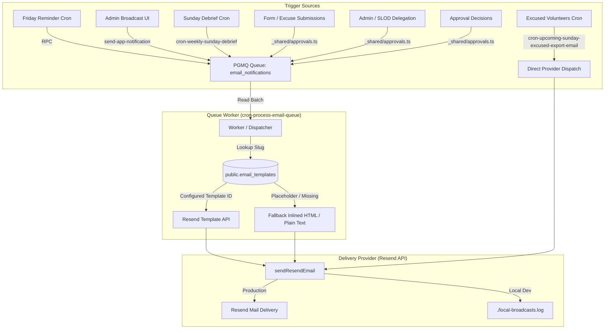

# Email Notifications & Templates Guide

This document provides a comprehensive inventory and architecture guide for all transactional, reminder, approval, and broadcast email notifications in Welcome Hub, detailing their triggers, target audiences, delivery pipelines, template slugs, and template variables.

---

## 1. High-Level Architecture & Delivery Pipeline

Welcome Hub supports two primary dispatch paths: **Asynchronous Queueing via PGMQ** (default for all notifications) and **Direct Provider Dispatch** (used for reporting crons with file attachments).

### 1.1 Asynchronous Delivery (PGMQ + `cron-process-email-queue`)

1. **Enqueueing**: Edge Functions and database routines call `enqueue_email_notification` (via `_shared/emailQueue.ts` or database RPC), enqueuing payloads into the `email_notifications` PGMQ queue.
2. **Immediate Trigger**: Enqueuing operations call `trigger_email_processor()`, invoking `cron-process-email-queue` directly or via the `trigger_email_processor` database RPC.
3. **Fallback Sweep**: A pg_cron job (`process_email_queue_15m` scheduled `*/15 * * * *`) sweeps the queue every 15 minutes to guarantee delivery even if immediate invocations time out or fail.
4. **Worker Execution**: `cron-process-email-queue` reads batches (up to 50 messages) and dispatches with up to 5 concurrent Resend requests.
5. **Template Resolution**: The worker reads `public.email_templates` by `template_slug`. If `resend_template_id` is configured (not empty and not containing `placeholder`), it passes `template_id` and metadata to Resend. If it is a placeholder or not found, it gracefully falls back to generating a responsive branded HTML email layout.

### 1.2 Local Broadcast Safety Harness

In local development (`LOCAL_BROADCAST=true` or non-production environment without active Resend API keys), all outbound emails dispatched through `sendResendEmail` (`_shared/resend.ts`) are safely intercepted and logged locally to `supabase/functions/local-broadcasts.log` instead of reaching real email addresses.

---

## 2. Email Notifications Inventory

| Event / Notification                          | Category              | Trigger Source                                                                                                                  | Recipient Audience                                               | Template Slug                   | Resend Template ID / Source                                                                | Dispatch Mode          |
| :-------------------------------------------- | :-------------------- | :------------------------------------------------------------------------------------------------------------------------------ | :--------------------------------------------------------------- | :------------------------------ | :----------------------------------------------------------------------------------------- | :--------------------- |
| **Volunteer Sunday Service Reminder**         | `sunday_reminder`     | Friday 06:00 Manila cron (`generate_upcoming_sunday_email_reminders_friday`)                                                    | Members committed for upcoming Sunday service                    | `volunteer-schedule`            | `volunteer-schedule` (Configured in Resend)                                                | Async PGMQ             |
| **Admin Multi-Channel Broadcast**             | `broadcast`           | Admin Broadcast (`/admin/notifications` via `send-app-notification`)                                                            | All members, specific role(s), specific user, or event attendees | `broadcast`                     | `tmpl_broadcast_placeholder` / `wrapPlainTextAsHtml` fallback                              | Async PGMQ             |
| **Sunday Executive Debrief**                  | `broadcast`           | Sunday evening cron / manual trigger (`cron-weekly-sunday-debrief`)                                                             | Officers-in-Charge (`role: 'OIC'`)                               | `sunday-executive-debrief`      | `tmpl_sunday_debrief_placeholder` / `formatSundayDebriefEmailText`                         | Async PGMQ             |
| **Approval Review Request**                   | `approval`            | Leave filing (`submit-service-excuse`), Form submission (`submit-form-submission`), or Delegation (`process-approval-decision`) | Assigned reviewer or SLOD user (`assigned_to_email`)             | `approval-review-request`       | `tmpl_approval_review_placeholder` / `email-templates/approval-review-request.html`        | Async PGMQ             |
| **Approval Outcome Notification**             | `approval`            | Reviewer or Admin decision (`process-approval-decision`)                                                                        | Requester member or submitter (`requester_email`)                | `approval-outcome-notification` | `tmpl_approval_outcome_placeholder` / `email-templates/approval-outcome-notification.html` | Async PGMQ             |
| **Upcoming Sunday Excused Volunteers Export** | System / Admin Export | Scheduled cron (`cron-upcoming-sunday-excused-export-email`)                                                                    | Administrative contact (`UPCOMING_SUNDAY_TARGET_EMAIL`)          | _None (Direct)_                 | Inline HTML summary table + CSV attachment                                                 | Direct Resend Dispatch |

---

## 3. Notification Specifications & Variable Schemas

### 3.1 Volunteer Sunday Service Reminder

- **Slug**: `volunteer-schedule`
- **Database Entry**: `public.email_templates` (`name: 'Volunteer Schedule Reminder'`)
- **Trigger**: Automatic cron on Friday at 06:00 Asia/Manila (`0 22 * * 4` UTC) calling `public.generate_upcoming_sunday_email_reminders_friday()`.
- **Recipient**: Any active user with an email and a scheduled commitment for the nearest upcoming Sunday (`first_sunday` through `fifth_sunday`).
- **Template Variables**:
  | Variable | Type | Description | Example |
  | :--- | :--- | :--- | :--- |
  | `user_id` | `string` | User unique identifier | `uuid-string` |
  | `first_name` | `string` | User first name | `"Juan"` |
  | `service_times` | `string` | Formatted Sunday service time slots | `"9:00 AM, 11:30 AM"` |
  | `sunday_date` | `string` | Date of the upcoming Sunday (`YYYY-MM-DD`) | `"2026-10-25"` |
  | `sunday_label` | `string` | Human-friendly Sunday label | `"4th Sunday"` |
  | `profile_url` | `string` | Deep link to user commitments tab | `"https://welcomehub.app/profile?tab=commitments"` |
  | `target_url` | `string` | Target destination link | `"https://welcomehub.app/profile"` |
- **Idempotency**: Tracked in `public.email_reminder_logs` per Sunday date to prevent duplicate batch generation.

---

### 3.2 Admin Multi-Channel Broadcast

- **Slug**: `broadcast`
- **Database Entry**: `public.email_templates` (`name: 'Broadcast Notification'`)
- **Trigger**: Administrator dispatches a broadcast announcement from `/admin/notifications` with the **Email** channel enabled.
- **Recipient**:
  - `all`: All active members with valid email addresses.
  - `role`: Members holding any of the selected auth or volunteer roles.
  - `user`: Specific user selected via autocomplete.
  - `event`: Registered members and public registrants of a specific event.
- **Template Variables**:
  | Variable | Type | Description | Example |
  | :--- | :--- | :--- | :--- |
  | `broadcast_title` | `string` | Broadcast subject / title | `"Important Service Update"` |
  | `broadcast_message` | `string` | Plain text broadcast body | `"Please note the room change..."` |
  | `broadcast_message_html` | `string` | HTML-formatted broadcast body with linkified URLs | `"Please note the room change... "` |
  | `action_url` | `string` | Call-to-action button URL | `"https://welcomehub.app/events/abc"` |
  | `action_text` | `string` | Call-to-action button label | `"View Event"` |
  | `target_type` | `string` | Broadcast audience scope | `"role"`, `"event"`, `"all"`, `"user"` |
- **Fallback Template**: If Resend template ID is not set or placeholder, `wrapPlainTextAsHtml()` wraps content in a responsive branded card with call-to-action button.

---

### 3.3 Sunday Executive Debrief

- **Slug**: `sunday-executive-debrief`
- **Database Entry**: `public.email_templates` (`name: 'Sunday Executive Debrief'`)
- **Trigger**: Automated cron or manual admin trigger of `cron-weekly-sunday-debrief`.
- **Recipient**: Members with the `OIC` (Officer-in-Charge) volunteer role.
- **Template Variables**:
  | Variable | Type | Description | Example |
  | :--- | :--- | :--- | :--- |
  | `sunday_date` | `string` | Sunday service date (`YYYY-MM-DD`) | `"2026-10-18"` |
  | `turnup_rate` | `number` | Attendance percentage turn-up | `87` |
  | `peak_slot` | `string` | Highest attended service slot | `"11:30 AM"` |
  | `total_committed` | `number` | Total scheduled volunteers | `120` |
  | `total_present` | `number` | Total volunteers present | `105` |
  | `total_walk_ins` | `number` | Unscheduled volunteer walk-ins | `6` |
  | `summary` | `string` | AI-generated executive summary | `"Sunday services ran smoothly..."` |
  | `key_highlights_html` | `string` | HTML bulleted list (`<ul><li>...</li></ul>`) | `formatKeyHighlightsHtml(highlights)` |
  | `action_url` | `string` | Link to admin services dashboard | `"https://welcomehub.app/admin/services"` |

---

### 3.4 Approval Review Request

- **Slug**: `approval-review-request`
- **Database Entry**: `public.email_templates` (`name: 'Approval Review Request'`)
- **Trigger**:
  - Volunteer files Long Leave (Service Excuse) via `/profile?tab=commitments` (`submit-service-excuse`).
  - Member or public guest submits a form requiring approval (`submit-form-submission`).
  - Administrator delegates a pending approval request to an SLOD user via `/admin/approvals` (`process-approval-decision`).
- **Recipient**: Assigned reviewer / SLOD user (`assigned_to_email`).
- **HTML Template**: Located in repository at `email-templates/approval-review-request.html`.
- **Programmatic Builder**: `buildApprovalReviewEmail` in `supabase/functions/_shared/emailTemplates/approvalReview.ts`.
- **Template Variables**:
  | Variable | Type | Description | Example |
  | :--- | :--- | :--- | :--- |
  | `subject_title` | `string` | Title of request for subject and headers | `"Long Leave: Juan Dela Cruz"` |
  | `heading` | `string` | Main email heading | `"Approval Required"` |
  | `description` | `string` | Context notice describing the review need | `"A request requires your review and approval:"` |
  | `review_url` | `string` | Tokenized secure review link | `"https://welcomehub.app/approvals/review/[access_token]"` |
  | `action_url` | `string` | Call-to-action button link | `"https://welcomehub.app/approvals/review/[access_token]"` |
  | `action_text` | `string` | Button text | `"Review & Take Action"` |
  | `details_html` | `string` | Key-value summary rows in styled HTML | Formatted labels & values |
  | `approval_id` | `string` | UUID of approval request | `uuid` |
  | `access_token` | `string` | Secure random token for passwordless sign-off | `random-token` |

---

### 3.5 Approval Outcome Notification

- **Slug**: `approval-outcome-notification`
- **Database Entry**: `public.email_templates` (`name: 'Approval Outcome Notification'`)
- **Trigger**: Reviewer or Admin approves or declines a request in `process-approval-decision`.
- **Recipient**: Submitter / Requester (`requester_email`).
- **HTML Template**: Located in repository at `email-templates/approval-outcome-notification.html`.
- **Programmatic Builder**: `buildApprovalOutcomeEmail` in `supabase/functions/_shared/emailTemplates/approvalOutcome.ts`.
- **Template Variables**:
  | Variable | Type | Description | Example |
  | :--- | :--- | :--- | :--- |
  | `title` | `string` | Title of original request | `"Long Leave: Juan Dela Cruz"` |
  | `requester_name` | `string` | Submitter name | `"Juan Dela Cruz"` |
  | `decision` | `string` | Decision status key | `"approved"` or `"rejected"` |
  | `decision_label` | `string` | Friendly status label | `"Approved"` or `"Declined"` |
  | `notes` | `string` | Optional reviewer remarks or justification | `"Approved after team alignment."` |
  | `approval_id` | `string` | UUID of approval request | `uuid` |

---

### 3.6 Upcoming Sunday Excused Volunteers Report (Direct Attachment)

- **Slug**: _None (Direct dispatch, bypasses PGMQ)_
- **Trigger**: Weekly cron execution of `cron-upcoming-sunday-excused-export-email`.
- **Recipient**: Configured operational target email (`UPCOMING_SUNDAY_TARGET_EMAIL`).
- **Subject**: `CCF Welcome Center — Excused Volunteers for Sunday (YYYY-MM-DD)`
- **Payload & Content**:
  - Summary HTML table of all members excused for the upcoming Sunday, listing names, scheduled service times, and reason categories.
  - Attached CSV file: `excused-volunteers-{sundayDate}.csv` containing member ID, name, date, services, reason, and email.

---

## 4. Admin Template Management (`/admin/settings/email-templates`)

Welcome Hub includes an admin settings view for managing email template associations:

- **Route**: `/admin/settings/email-templates`
- **Database Table**: `public.email_templates`
- **Fields**:
  - `slug` (`text`, unique): Identifier referenced by Edge Functions (e.g. `approval-review-request`).
  - `name` (`text`): Display name for the template.
  - `resend_template_id` (`text`): The template ID registered in the Resend dashboard.
  - `required_variables` (`jsonb`): List of variables expected by the template.
- **Workflow**:
  1. Design and export the HTML email template (e.g., from `email-templates/*.html`).
  2. Create a template in Resend (`https://resend.com/templates`), paste the HTML, and copy the assigned Resend Template ID.
  3. Navigate to `/admin/settings/email-templates` in Welcome Hub and save the Resend Template ID against the corresponding slug.
  4. Outbound emails will immediately render using the updated Resend template. If set to a placeholder, the system defaults to programmatic HTML builders.

---

## 5. Related Documentation

- [Automated Sunday Email Reminders](automated-sunday-email-reminders.md)
- [Automated Sunday Push Reminders](automated-sunday-push-reminders.md)
- [Unified Approval Workflow & SLOD Delegation](unified-approval-workflow-and-slod-delegation.md)
- [Multi-Channel Notifications Architecture](notifications-deployment-and-mobile-testing.md)
