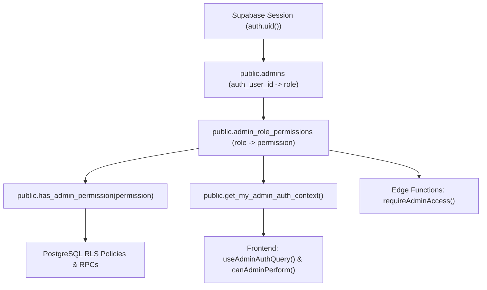

# Role-Based Access Control (RBAC) Architecture

This guide documents the end-to-end Role-Based Access Control (RBAC) architecture across PostgreSQL (RLS & RPCs), Supabase Edge Functions, and the React frontend.

---

## 1. Overview & Single Source of Truth

The application enforces RBAC using **PostgreSQL as the single source of truth** for both role assignments and role-to-permission grants:

1. **User Role Assignments (`public.admins`)**: Maps `auth.users.id` (`auth_user_id`) to a single administrative role (`super_admin`, `admin`, `slod`, `imt`, or `kiosk`).
2. **Role Permission Matrix (`public.admin_role_permissions`)**: Maps each `role` to its granted `permission` keys.
3. **Database Helper (`public.has_admin_permission(p_permission text)`)**: Evaluates whether the currently authenticated user (`auth.uid()`) holds a given permission.
4. **Auth Context RPC (`public.get_my_admin_auth_context()`)**: Returns `{ role, permissions: text[] }` for the active session user so the frontend consumes backend-resolved permissions directly.



---

## 2. Roles & Permission Matrix

### Roles (`AdminRole`)

| Role          | Description                                                                                                                                                           | Assignable via UI? |
| :------------ | :-------------------------------------------------------------------------------------------------------------------------------------------------------------------- | :----------------: |
| `super_admin` | Full administrative access plus user role management (`/admin/settings/roles`). Protected from modification or revocation via UI/Edge Functions.                      |   No (Protected)   |
| `admin`       | Full read/write administrative access across events, forms, members, services, approvals, and settings.                                                               |        Yes         |
| `slod`        | Service Leader of the Day. Read-only access to events, forms, members, and dashboards, plus management of attendance saved views, CSV exports, and service schedules. |        Yes         |
| `imt`         | Information Management Team. Read-only access to member directory, member details, and dashboards.                                                                    |        Yes         |
| `kiosk`       | Dedicated check-in operator role restricted to event attendance check-in workflows.                                                                                   |        Yes         |

### Permission Grants (`public.admin_role_permissions`)

| Permission Key (`AdminPermissionKey`) | `super_admin` | `admin` | `slod` | `imt` | `kiosk` |
| :------------------------------------ | :-----------: | :-----: | :----: | :---: | :-----: |
| `canManageAdminRoles`                 |      Yes      |   No    |   No   |  No   |   No    |
| `canWriteAdminData`                   |      Yes      |   Yes   |   No   |  No   |   No    |
| `canReadAdminData`                    |      Yes      |   Yes   |  Yes   |  No   |   No    |
| `canReadAdminMemberData`              |      Yes      |   Yes   |  Yes   |  Yes  |   No    |
| `canManageAttendanceSavedViews`       |      Yes      |   Yes   |  Yes   |  No   |   No    |
| `canExportAdminReports`               |      Yes      |   Yes   |  Yes   |  No   |   No    |
| `canViewMemberHistory`                |      Yes      |   Yes   |  Yes   |  No   |   No    |
| `canReadDashboard`                    |      Yes      |   Yes   |  Yes   |  Yes  |   No    |
| `canManageServices`                   |      Yes      |   Yes   |  Yes   |  No   |   No    |
| `canAccessAttendanceCheckIn`          |      Yes      |   Yes   |   No   |  No   |   Yes   |

---

## 3. PostgreSQL Layer (RLS & Security-Definer Functions)

Defined in:

- `supabase/migrations/20261101183000_create_admin_role_permissions_table.sql`
- `supabase/migrations/20261101183100_add_rbac_permission_helpers_and_rpc.sql`

### SQL Permission & Role Helpers

- **`public.has_admin_permission(p_permission text)`**:
  Joins `public.admins` and `public.admin_role_permissions` for `auth.uid()` to check if `p_permission` is granted.
- **Role-Group Helpers (Backed by `has_admin_permission`)**:
  - `public.is_super_admin()` -> `public.has_admin_permission('canManageAdminRoles')`
  - `public.is_admin()` -> `public.has_admin_permission('canWriteAdminData')`
  - `public.is_admin_viewer()` -> `public.has_admin_permission('canReadAdminData')`
  - `public.is_admin_member_viewer()` -> `public.has_admin_permission('canReadAdminMemberData')`
  - `public.is_kiosk()` -> checks `role = 'kiosk'` on `public.admins` (used for kiosk-specific RLS policies).

---

## 4. Supabase Edge Functions Layer

Defined in:

- `supabase/functions/_shared/security.ts` (`requireAdminAccess`)
- `supabase/functions/_shared/edge.ts` (`useEdgeHook`)

Edge Functions with `requireAdmin: true` can authorize callers by either:

1. **Permission-based guard (`requiredPermission`)**:
   ```ts
   const guard = await useEdgeHook({
     req,
     functionName: 'my-function',
     requireAdmin: true,
     requiredPermission: 'canExportAdminReports', // or array of AdminPermissionKey
   });
   ```
   `requireAdminAccess` verifies the caller's JWT, resolves their `role` from `public.admins`, and queries `public.admin_role_permissions` to confirm the role holds at least one of the required permissions.
2. **Role allowlist (`allowedRoles`)**:
   Supported for role-specific endpoints (defaults to `['admin', 'super_admin']` when neither `requiredPermission` nor `allowedRoles` is specified).

---

## 5. Frontend Layer

Defined in:

- `src/lib/domain/auth/api.ts` (`fetchMyAdminAuthContext`)
- `src/lib/domain/auth/queries.ts` (`fetchAdminAuthState`)
- `src/lib/domain/auth/permissions.ts` (`canAdminPerform`)
- `src/hooks/domain/auth/useAdminAuthQuery.ts` (`useAdminAuthQuery`, returning `can(permission)`)
- `src/config/constants/routes.ts` (`APP_ROUTE_DEFINITIONS`)
- `src/app/router.tsx` (`RequireAdminAuth`)

### How the Frontend Resolves & Checks Permissions

1. **Session & Context Resolution**:
   `useAdminAuthQuery()` calls `fetchAdminAuthState()`, which invokes the `get_my_admin_auth_context` RPC and returns:
   ```ts
   {
     isAuthenticated: true,
     session,
     adminRole: 'slod',
     permissions: ['canExportAdminReports', 'canManageAttendanceSavedViews', ...],
   }
   ```
   There is **no** static role-to-permission fallback on the frontend; `canAdminPerform` strictly requires backend-returned `permissions`.
2. **Route Guards (`RequireAdminAuth`)**:
   Routes in `src/config/constants/routes.ts` declare `requiredPermission` (a single `AdminPermissionKey` or an array of `AdminPermissionKey` where any match grants access, e.g., `['canReadAdminData', 'canAccessAttendanceCheckIn']` for `/admin/events`). `RequireAdminAuth` evaluates `can(requiredPermission)` from `useAdminAuthQuery()`.
3. **Component UI Gating**:
   Components destructure `const { can } = useAdminAuthQuery()` and check `can('canWriteAdminData')` (backed by a memoized `ReadonlySet<AdminPermissionKey>` and `canAdminPerform`) to conditionally render action buttons, navigation tabs, and forms.
