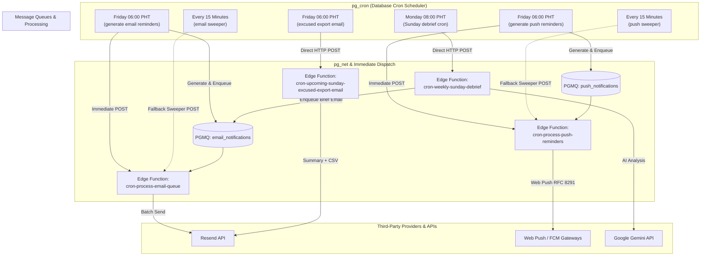
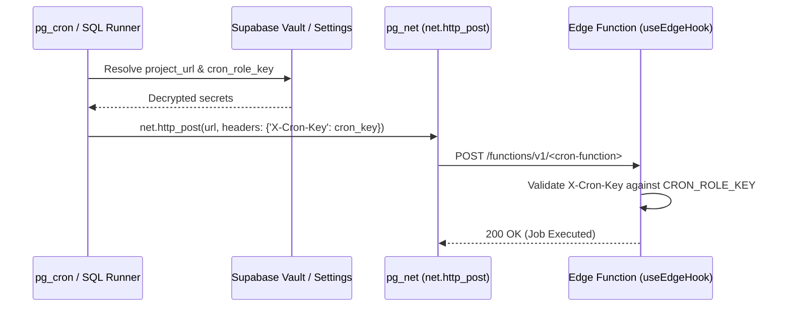

# Scheduled Jobs & Automated Crons Guide

This document is the master architectural and operational guide for all recurring and scheduled background workloads in Welcome Hub. It covers database cron jobs (`pg_cron`), Edge Function workers (`pg_net`), asynchronous queues (`pgmq`), and infrastructure automation workflows (GitHub Actions).

---

## 1. High-Level Architecture

The repository employs a decoupled, fault-tolerant background architecture:



---

## 2. Master Schedules & Catalog

All cron schedules defined in PostgreSQL migrations run against **UTC**. The application business schedule operates in **Asia/Manila (PHT / UTC+8)**.

### 2.1 Database & Edge Function Cron Jobs (`pg_cron`)

| Job Identifier                                    | Cron Expression | UTC Schedule     | Asia/Manila (PHT) | Worker / Target                                                                                      | Idempotency / Deduplication                                              |
| :------------------------------------------------ | :-------------- | :--------------- | :---------------- | :--------------------------------------------------------------------------------------------------- | :----------------------------------------------------------------------- |
| `generate_upcoming_sunday_email_reminders_friday` | `0 22 * * 4`    | Thursday 22:00   | Friday 06:00      | `public.generate_and_dispatch_upcoming_sunday_email_reminders()` &rarr; `cron-process-email-queue`   | Checked via `public.email_reminder_logs.sunday_date` (unique constraint) |
| `process_email_queue_15m`                         | `*/15 * * * *`  | Every 15 minutes | Every 15 minutes  | `cron-process-email-queue` via `net.http_post`                                                       | PGMQ visibility timeout (30s) + message archiving                        |
| `generate_upcoming_sunday_push_reminders_friday`  | `0 22 * * 4`    | Thursday 22:00   | Friday 06:00      | `public.generate_and_dispatch_upcoming_sunday_push_reminders()` &rarr; `cron-process-push-reminders` | Checked via `public.push_reminder_logs.sunday_date` (unique constraint)  |
| `process_push_reminders_15m`                      | `*/15 * * * *`  | Every 15 minutes | Every 15 minutes  | `cron-process-push-reminders` via `net.http_post`                                                    | PGMQ visibility timeout (30s) + message archiving                        |
| `upcoming_sunday_excused_export_email_friday`     | `0 22 * * 4`    | Thursday 22:00   | Friday 06:00      | `cron-upcoming-sunday-excused-export-email` via `net.http_post`                                      | Rate limited (`1 hit/60s`) + generated once per Friday trigger           |
| `weekly_sunday_debrief_monday_morning`            | `0 0 * * 1`     | Monday 00:00     | Monday 08:00      | `cron-weekly-sunday-debrief` via `net.http_post`                                                     | Deduplicated by target Sunday in `public.service_weekly_briefs`          |

### 2.2 Maintenance & On-Demand Cron Functions

| Function Name         | Location                                 | Trigger Method                          | Purpose                                                                                 |
| :-------------------- | :--------------------------------------- | :-------------------------------------- | :-------------------------------------------------------------------------------------- |
| `cron-tokenize-users` | `supabase/functions/cron-tokenize-users` | Admin RPC / HTTP POST with `X-Cron-Key` | Runs `tokenize_all_users()` to backfill or refresh search tokens across `public.users`. |

### 2.3 Infrastructure & CI/CD Scheduled Workflows (GitHub Actions)

| Workflow File                              | Cron Expression | Schedule (UTC)                  | Purpose                                                                                                 |
| :----------------------------------------- | :-------------- | :------------------------------ | :------------------------------------------------------------------------------------------------------ |
| `.github/workflows/supabase-backup.yml`    | `0 17 * * 0`    | Sunday 17:00 (Monday 01:00 PHT) | Runs `pg_dump` on production PostgreSQL database, compresses dump, and uploads to Cloudflare R2 bucket. |
| `.github/workflows/supabase_keepalive.yml` | `0 0 */4 * *`   | Every 4 days at 00:00           | Headless Playwright browser ping to prevent Supabase inactivity pausing.                                |
| `.github/workflows/codeql.yml`             | `30 3 * * 1`    | Monday 03:30                    | Automated security code scanning and vulnerability detection across TypeScript/JavaScript.              |

---

## 3. Security, Authentication & Secret Resolution

All HTTP invocations initiated by database cron jobs use a secure multi-layer authorization scheme:



### 3.1 Vault Resolution Strategy

To ensure credentials remain decoupled from SQL migrations, scheduled jobs query Supabase Vault first, falling back to database parameters:

```sql
select
  coalesce(
    (
      select
        decrypted_secret
      from
        vault.decrypted_secrets
      where
        name = 'project_url'
      limit
        1
    ),
    current_setting ('app.settings.project_url', true)
  ) as project_url,
  coalesce(
    (
      select
        decrypted_secret
      from
        vault.decrypted_secrets
      where
        name = 'cron_role_key'
      limit
        1
    ),
    current_setting ('app.settings.cron_role_key', true)
  ) as cron_role_key;
```

### 3.2 Edge Function Header Verification

Edge functions that handle cron jobs configure `useEdgeHook` with:

- `allowCronRole: true`
- `allowServiceRole: true`
- `requireAdmin: true`

`useEdgeHook` validates that incoming requests carry an `X-Cron-Key` matching the server environment `CRON_ROLE_KEY`.

---

## 4. Workload Details & Operational Runbooks

### 4.1 Sunday Volunteer Reminders (Email & Push)

- **Generation (Friday 06:00 PHT)**:
  1. Computes the upcoming Sunday date relative to Manila timezone (`Asia/Manila`).
  2. Resolves Sunday commitment metadata (`first_sunday` through `fifth_sunday`) for all active users.
  3. Checks idempotency:
     - Emails: Writes to `email_reminder_logs(sunday_date)`. If an entry exists, returns `0`.
     - Push: Writes to `push_reminder_logs(sunday_date)`. If an entry exists, returns `0`.
  4. Enqueues messages to PGMQ (`email_notifications` and `push_notifications`).
  5. Fires an **immediate execution** via `pg_net` (`trigger_email_processor()` or `trigger_push_reminder_processor()`).
- **Sweeper Fallback (Every 15 minutes)**:
  - `process_email_queue_15m` and `process_push_reminders_15m` ping the workers every 15 minutes to drain any remaining messages, handling transient network errors or rate limit pauses.

### 4.2 Excused Volunteers Leadership Export (`cron-upcoming-sunday-excused-export-email`)

- **Schedule**: Every Friday at 06:00 AM PHT (`0 22 * * 4` UTC).
- **Process**:
  1. Queries `approved_service_excuse_sundays_view` for members with approved leave covering the upcoming Sunday.
  2. Renders an HTML summary table broken down by service time.
  3. Formats an attached CSV file (`excused-volunteers-YYYY-MM-DD.csv`).
  4. Sends directly to `UPCOMING_SUNDAY_TARGET_EMAIL` via Resend API.

### 4.3 Weekly Sunday Debrief (`cron-weekly-sunday-debrief`)

- **Schedule**: Every Monday at 08:00 AM PHT (`0 0 * * 1` UTC).
- **Process**:
  1. Retrieves finalized attendance and volunteer statistics for the preceding Sunday via `get_service_dashboard_attendance_summary`.
  2. Submits anonymized metrics to Google Gemini AI to analyze volunteer turnout rates, deficit patterns, and key operational takeaways.
  3. Upserts the debrief into `public.service_weekly_briefs`.
  4. Enqueues a notification email to administrators with the executive summary and a direct link to the Services Dashboard ([`/admin/services`](/admin/services)).

---

## 5. Inspection, Monitoring & Manual Testing

### 5.1 Inspecting Active Database Crons

Run in the Supabase SQL Editor:

```sql
-- View all registered cron jobs
select
  jobid,
  jobname,
  schedule,
  active,
  command
from
  cron.job
order by
  jobname;

-- Inspect execution history and failures
select
  jobid,
  runid,
  job_pid,
  status,
  return_message,
  start_time,
  end_time
from
  cron.job_run_details
order by
  start_time desc
limit
  25;
```

### 5.2 Manually Triggering a Scheduled Job

To trigger any cron job manually outside its scheduled window:

```sql
-- Trigger Email Reminders Generation & Worker
select
  public.generate_and_dispatch_upcoming_sunday_email_reminders ();

-- Trigger Push Reminders Generation & Worker
select
  public.generate_and_dispatch_upcoming_sunday_push_reminders ();

-- Trigger Queue Sweepers Directly
perform public.trigger_email_processor ();

perform public.trigger_push_reminder_processor ();
```

To invoke an Edge Function worker directly via HTTP terminal:

```bash
curl -X POST "https://<PROJECT_REF>.supabase.co/functions/v1/cron-process-email-queue" \
  -H "Content-Type: application/json" \
  -H "X-Cron-Key: <CRON_ROLE_KEY>"
```

### 5.3 Unregistering or Rescheduling a Job

Always follow the standard unschedule-before-schedule pattern:

```sql
begin;
do $$
begin
  perform cron.unschedule('job_name_here');
exception when others then
  null;
end $$;

select cron.schedule(
  'job_name_here',
  '0 22 * * 4',
  $$ select public.some_scheduled_function(); $$
);
commit;
```

---

## 6. Related Documentation

- [Automated Sunday Email Reminders Guide](file:///Users/baronpatrickparedes/Projects/wc-event-registration/docs/guides/automated-sunday-email-reminders.md)
- [Automated Sunday Service Push Reminders Guide](file:///Users/baronpatrickparedes/Projects/wc-event-registration/docs/guides/automated-sunday-push-reminders.md)
- [Email Notifications & Templates Reference](file:///Users/baronpatrickparedes/Projects/wc-event-registration/docs/guides/email-notifications-and-templates.md)
- [Database Backup Guide](file:///Users/baronpatrickparedes/Projects/wc-event-registration/docs/guides/backup-guide.md)
- [Background Jobs Skill](file:///Users/baronpatrickparedes/Projects/wc-event-registration/.agent/skills/background-jobs/skill.md)
