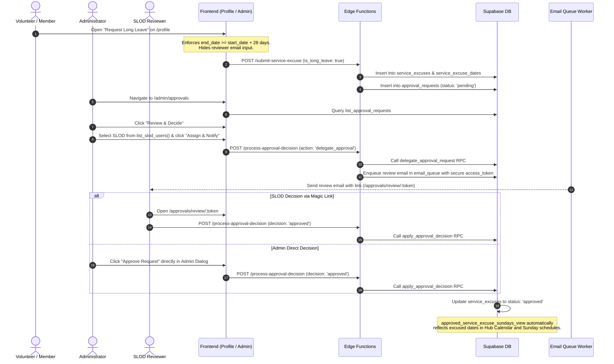

# Unified Approval Workflow & SLOD Delegation Guide

This document describes the design, architecture, database schema, security model, and user workflows for the **Unified Approval Workflow** and **SLOD Delegation** system in the Welcome Center Event Registration platform.

---

## 1. Overview & Purpose

### The Problem

As organizational operations scale, multiple entities require formal sign-off before becoming active:

- **Form Submissions**: Registrations or applications requiring leader verification.
- **Volunteer Long Leave (Service Excuses)**: Extended leaves of absence (e.g. sabbaticals, maternity/paternity leave, work assignments) that exempt volunteers from Sunday commitments across multiple weeks.

Previously, approvals were handled informally or directly via ad-hoc database updates. Administrators had no centralized inbox to track pending requests, and volunteers had to manually communicate with individual service leaders (SLODs).

### The Solution

The **Unified Approval Workflow** centralizes all approval operations:

1. **Generic Approvals Inbox (`/admin/approvals`)**: A single pane of glass for administrators to inspect, filter, approve, or decline requests across forms and volunteer leaves.
2. **Streamlined Member Self-Filing**: Members can self-file Long Leave directly from their Profile page without needing to know or enter reviewer contact emails.
3. **Mandatory 4-Week Validation**: Long Leave requests must span at least 4 weeks (28 days / 4 Sunday services).
4. **SLOD Delegation**: Administrators can delegate pending requests to any user with the `slod` role, automatically dispatching an email with a secure review token link.
5. **Dual Decision Authority**: The designated SLOD can review and decide via their secure link, while Administrators retain the authority to approve or decline directly at any time.

---

## 2. End-to-End Workflow & Architecture



---

## 3. Database Schema & Security

The system is powered by two migrations:

- `20261018114500_create_unified_approval_workflow.sql`
- `20261018233000_support_slod_delegation.sql`

### 3.1 `approval_requests` Table

The central registry for all workflow decisions:

| Column                | Type              | Description                                                       |
| --------------------- | ----------------- | ----------------------------------------------------------------- |
| `id`                  | `uuid`            | Primary key (`gen_random_uuid()`).                                |
| `entity_type`         | `text`            | Discriminator (`'form_submission'`, `'service_excuse'`).          |
| `entity_id`           | `uuid`            | Foreign identifier of the underlying target record.               |
| `title`               | `text`            | Display title for lists and cards.                                |
| `summary`             | `text`            | Brief human-readable summary of the request.                      |
| `requester_user_id`   | `uuid`            | Optional FK to `public.users(id)`.                                |
| `requester_name`      | `text`            | Name of the person requesting sign-off.                           |
| `requester_email`     | `text`            | Contact email of the requester.                                   |
| `metadata`            | `jsonb`           | Entity-specific context (e.g. leave dates, dietary notes).        |
| `status`              | `approval_status` | Enum: `'pending'`, `'approved'`, `'rejected'`.                    |
| `assigned_to_email`   | `text`            | Optional email of delegated reviewer.                             |
| `assigned_to_user_id` | `uuid`            | Optional FK to `auth.users(id)`.                                  |
| `decided_by_user_id`  | `uuid`            | FK to `auth.users(id)` when decided by authenticated user.        |
| `decided_by_email`    | `text`            | Email of the final decider.                                       |
| `decided_at`          | `timestamptz`     | When the decision was finalized.                                  |
| `decision_notes`      | `text`            | Optional administrator or reviewer guidance.                      |
| `access_token`        | `text`            | Secure cryptographic token for unauthenticated magic-link review. |
| `token_expires_at`    | `timestamptz`     | Token expiry timestamp.                                           |
| `token_used_at`       | `timestamptz`     | Timestamp when the token was consumed.                            |

### 3.2 Database Views & RLS Policies

All views strictly adhere to repository security standards using `security_invoker = true`:

```sql
create
or replace view public.approved_service_excuse_sundays_view
with
  (security_invoker = true) as
select
  sed.user_id,
  sed.service_date,
  sed.time_slot,
  se.reason,
  se.status,
  se.is_long_leave
from
  public.service_excuse_dates sed
  join public.service_excuses se on se.id = sed.service_excuse_id
where
  se.status = 'approved';
```

RLS on `approval_requests`:

- **Read**: Authenticated administrators (`is_admin_viewer() = true`) OR token matching (`access_token = current_setting(...)`).
- **Update**: Restricted to `service_role` (invoked via security-definer RPCs and Edge Functions).

### 3.3 Database RPCs

1. **`public.list_slod_users()`**:
   - `SECURITY DEFINER` with `search_path = public`.
   - Restricted to administrators (`is_admin_viewer()`).
   - Returns all active users in `public.admins` where `role = 'slod'`:
     ```sql
     select
       auth_user_id,
       email,
       name,
       avatar_object_key
     from
       list_slod_users ();
     ```
2. **`public.delegate_approval_request(p_approval_id, p_assigned_to_email, p_assigned_to_user_id)`**:
   - Updates `assigned_to_email`, `assigned_to_user_id`, and `updated_at`.
   - Validates that the request is currently in `'pending'` status.
3. **`public.apply_approval_decision(p_approval_id, p_decision, p_notes, ...)`**:
   - Transitions `approval_requests.status` to `'approved'` or `'rejected'`.
   - Synchronizes underlying domain entities (e.g., updates `service_excuses.status = 'approved'`).

---

## 4. Edge Functions

### 4.1 `process-approval-decision`

The edge function handles both decision applications and review delegations.

- **Endpoint**: `POST /process-approval-decision`
- **Actions**:
  - `action: 'decide'` (Default):
    - Validates token or authenticated admin session.
    - Calls `apply_approval_decision` RPC.
  - `action: 'delegate_approval'`:
    - Validates authenticated admin session.
    - Schema: `{ approval_id: string, action: 'delegate_approval', assigned_to_email: string, assigned_to_user_id?: string }`.
    - Invokes `delegate_approval_request` RPC.
    - Generates and enqueues an HTML notification email via `enqueueApprovalReviewEmail` targeting the SLOD reviewer.

### 4.2 `submit-service-excuse`

Handles submission of single-Sunday and multi-week Long Leave requests.

- When `is_long_leave: true`, validates start/end dates and automatically populates all intervening Sunday dates in `service_excuse_dates`.
- Creates a corresponding `approval_requests` record with `entity_type: 'service_excuse'`.

---

## 5. Frontend Components & User Experience

### 5.1 Member Self-File Modal (`RequestLongLeaveModal.tsx`)

- **Accessible Location**: User profile page (`/profile?tab=commitments`).
- **Input Fields**:
  - `Start Date (Sunday)` (date picker, helper text: "Must be a Sunday service date")
  - `End Date (Sunday)` (date picker, helper text: "Must be a Sunday service date")
  - `Reason for Extended Leave` (text area)
- **Validation Rules**:
  - **Sunday-Only Dates**: Both `start_date` and `end_date` are strictly validated to fall on a Sunday (`date.getDay() === 0`).
  - **Minimum 4-Week Duration**: `end_date >= start_date + 28 days` validates that the leave duration spans at least 4 weeks (28 days / 4 Sundays). Shows a clear inline error if an insufficient window is selected.
  - Form validation handled via React Hook Form and Zod (`longLeaveFormSchema`).
- **Audience Mode**:
  - **Member View (`isAdminView: false`)**: Reviewer email field is completely omitted.
  - **Admin View (`isAdminView: true`)**: Includes an optional SLOD delegate dropdown (`FormSelectField`), allowing filing admins to pre-delegate the review upon creation.

### 5.2 Admin Approvals Inbox (`/admin/approvals`)

- **Layout**: Uses `AdminPageShell` with `ButtonGroup` status tabs (`Pending`, `Approved`, `Declined`, `All`) and request type filters (`All`, `Form Registrations`, `Long Leave Requests`).
- **Responsive Views**:
  - **Desktop**: `ListTable` showing Request title, Entity badge, Requester with `Avatar`, submission date, status badge, and assigned reviewer pill.
  - **Mobile**: `MobileCard` with structured items and full touch-target review buttons.
- **Review & Decide Dialog**:
  - Displays requester avatar, email, and metadata breakdown.
  - **Assignment & Delegation Box**:
    - Displays current reviewer (`Assigned to: {name} ({email})` or `Unassigned (Open to all Admins)`).
    - Dropdown populated via `useSlodUsersQuery()`.
    - **Assign & Notify** button triggering `useDelegateApprovalMutation()`.
  - **Direct Decision Buttons**:
    - `Approve Request` and `Decline` buttons are always accessible to Administrators, guaranteeing that admins can decide directly at any time.

---

## 6. Verification & Automated Testing

### Test Coverage

1. **Edge Function Tests (`supabase/functions/process-approval-decision/__tests__/handler.test.ts`)**:
   - Tests approval decisions via session user.
   - Tests approval decisions via access token.
   - Tests `action: 'delegate_approval'` and review email queueing.
   - 486 Deno unit tests validated via `npm run test:edge`.

2. **Frontend Component Tests**:
   - `RequestLongLeaveModal.test.tsx`:
     - Verifies reviewer email field is hidden in member mode.
     - Verifies SLOD selector renders in admin mode.
     - Verifies 28-day duration validation error is displayed when `< 28 days` is entered.
     - Verifies valid submission dispatches the expected payload.
   - `AdminApprovalsPage.test.tsx`:
     - Verifies metrics and list rendering.
     - Verifies delegation selector and mutation dispatch.
     - Verifies admin direct approval bypasses delegation requirement.

3. **CI & Pre-commit Validation**:
   - All formatting, linting, TypeScript build, and Vitest unit tests pass in `npm run precommit`.
